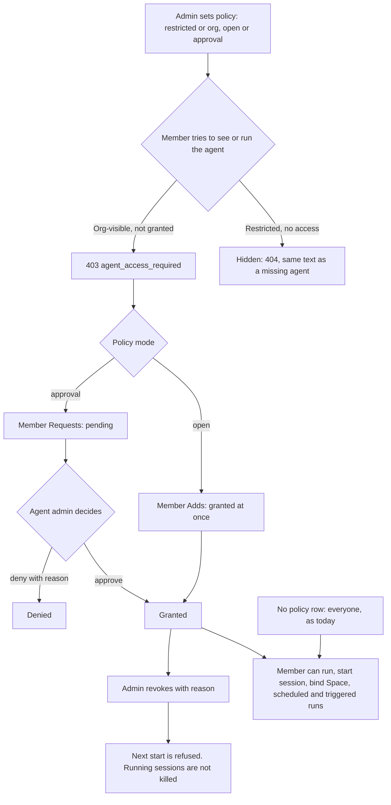

# Agent access — Phase 1 breakdown (draft for the owner)

## 1. What Phase 1 solves

Today every agent in the catalog is visible and runnable by every member of the org. Phase 1 makes
agents **hidden by default** where an admin wants that, and lets a member get access in two ways:
**Add** (open agent, granted at once) or **Request** (approval agent, an admin decides). It builds the
storage, the one access rule, enforcement at every place a run or session can start, and the four write
routes (set policy, add/request, decide, revoke) so end-to-end scenarios can prove the whole flow
through the API. Browse lists, notifications, CLI and the app come in later phases. Nothing changes for
existing agents on upgrade.

## 2. Flow: what Phase 1 implements

## 3. Issues found and how each is resolved

| # | Existing problem | Resolution |
|---|---|---|
| 1 | The design puts the rule inside the store reads, but running sessions use the same reads on every tool call, so a revoke would break live sessions (against A7). | Separate unchecked reads for already-admitted sessions (boot, resume, tool-call policy). The rule applies only at admission. |
| 2 | A refused run still creates a default Space and thread, and binds the agent, before the agent is checked. | Check the agent before any Space or thread is created or bound (AA-1.5). |
| 3 | Four admission sites were missing from the design: release-suggestion (answers a hidden agent with 403, which leaks it exists), legacy `POST /v1/sessions` on a bound Space, steer/queue, default Space creation. | All added to the enforcement list; each gets a test. |
| 4 | "Hidden looks like a missing agent" is really four different texts depending on the route. | Each route returns its own missing-agent text exactly, tested byte for byte. |
| 5 | The `(org, approval)` default for installs shares a write path with updates, so a pre-upgrade install would hide at its next update. | Write the default on first install only. |
| 6 | That default also makes members get 403 in 10 existing marketplace scenarios. | One setup line each (admin opens the agent to everyone), landed in W2 with the route. |
| 7 | Scenarios cannot send request bodies or keep returned ids today. | W0 extends the e2e runner (`body`, `remember`, `{{urn:<piece>}}`). |

## 4. Outcomes

- A member cannot see or run a restricted agent; a hidden agent is indistinguishable from a missing one.
- Request, approve, run works; Add on an open agent, run works; revoke stops the next start, including scheduled and triggered runs, without killing running sessions.
- A publisher who first releases an agent becomes its admin; existing agents behave exactly as before.
- 7 new scenarios green, 10 existing ones adjusted, `cargo test -p vam-orchestrator` green.
- Stop point after W2: tables, rule, enforcement and open Add work, so you can try it with `curl` before approval mode lands in W3.

## 5. Questions (recommended answer first)

1. Land the 10 scenario setup lines in W2 with the route (not W0)? **Recommend yes.**
2. Refuse steer/queue into a live task once access is lost? **Recommend yes.**
3. Sessions admitted before a revoke keep running and resuming; only new starts are refused? **Recommend yes.**
4. `POST …/access` by someone who can already use the agent answers 409 "already usable"? **Recommend yes.**
5. Non-admin decide answers 404; policy/revoke on a visible agent 403, on a hidden one 404; reason required on revoke; `(restricted, everyone)` refused with 400? **Recommend yes to all.**

## 6. Confirmation

Reply "approved" to accept the breakdown and all five recommendations, or answer the questions you want
changed. I start W0 only after that.

---

## Detail for the build (waves, items, scenarios)

Read-only breakdown by the Opus breakdown agent, 2026-11-27, against `feat/agent-access` @ 3816531.
Format: `phase-playbook.md` §3 step 2 and §11. Line cites checked on that head. Item prefix `AA-1.n`.
Not yet committed to the tracker (the phase session pastes it under Phase 1 as
`docs(agent-access): Phase 1 breakdown` once the owner approves).

**Goal (reworded).** The three tables; the one rule (design §2.3) in the store's agent reads; every
admission site refuses Hidden (404, the route's missing-URN text) and Visible (403
`agent_access_required:`); the Space is created or bound only after admission. Phase 1 also ships,
at their final design §4 paths and §6 JSON (scenarios act only through the API and CLI):
`PUT /v1/agents/{urn}/access-policy`, `POST /v1/agents/{urn}/access` (Add for `open`, Request for
`approval`), `POST /v1/access-requests/{id}/decide`, `POST /v1/agents/{urn}/access/{userId}/revoke`.
Phase 2 keeps browse, `GET /v1/me/access`, `GET /v1/access-requests`, `DELETE …/access`, admins,
`/v1/me` additions, notifications, OpenAPI, proto.

**Phase rubric.** `Decide: NOW — proof 3 (owner goal; P1 override: a missed admission site admits or
leaks a hidden agent), cost 2 (one phase: three tables, four routes, no proto, no guest path)`.
`lane: no` for every wave (no guest or VM code; the release PR runs the lane anyway).

## 1. Code map and outline

### 1.1 Admission sites that must go through the rule (all of them)

| # | Site | Read today | Hidden text (byte for byte = missing URN on that route) |
|---|---|---|---|
| 1 | `GET /v1/agents` | `api/mod.rs:796-813` → `list_agent_records_visible` `catalog.rs:947-988` | not listed (Visible also not listed) |
| 2 | `GET /v1/agents/{urn}` | `api/mod.rs:666-670` → `get_catalog_record_visible` `catalog.rs:1512-1531` | `agents '<urn>' not found in catalog` (`catalog.rs:1683-1686`) |
| 3 | `GET …/versions` | `api/mod.rs:647-648` → `catalog_release.rs:127-146` → `query_catalog_versions` `catalog.rs:576-617` (no rule today) | `agents '<urn>' has no versions visible to this caller` (`catalog.rs:612-614`) |
| 4 | `GET …/outcomes` | `api/mod.rs:650-659` → `outcomes.rs:39-51` (same `list_catalog_versions`) | same as 3 (`outcomes.rs:48-50`) — covered once 3 has the rule |
| 5 | `GET …/release-suggestion` | `api/mod.rs:660-661` → `release_suggestion.rs:35` → `catalog_auth.rs:93-103` → `owner.rs:397-411` (owner check, **no visible read**: Hidden answers 403 "only the artifact owner…", a leak) | rule first, after `require_publish_grant`: `agent '<urn>' not found` (`owner.rs:383`) |
| 6 | `GET …/permissions` (explain, versioned) | `api/mod.rs:642-643` → `permissions_view.rs:645` (design says :634) | at-version text (row 8) |
| 7 | `POST /v1/runs`, queued start, triggered/scheduled fire | `api/mod.rs:1464`, `api/queue.rs:178`, `gateway.rs:709` → `start_run` → `run_start.rs:359-387` `load_agent_for_run` (`catalog_resolve.rs:43-55`); gateway maps 403/404 to `DENIED AGENT_UNAVAILABLE` (`gateway.rs:790-796`) | row 2 text, or row 8 for a pinned version |
| 8 | version-pinned reads | `get_agent_at_version_visible` `catalog.rs:877-895` | `agents '<urn>' X.Y.Z[-pre] not found in catalog` (`catalog.rs:501-512`); draft pin `no draft of agent '<urn>' for this user` (`catalog.rs:50-52`) |
| 9 | `POST /v1/spaces {agentUrn}` | `api/spaces.rs:146-149` `get_agent_visible` | row 2 text |
| 10 | run grant for another agent (host tool) | `grants.rs:229-243` (`:238`, design says :237) | tool refusal `agent_not_found: no agent with that urn that you may run` for Hidden **and** Visible (`.is_err()`); unchanged |
| 11 | `POST /v1/agent-checks` | `api/composition.rs:69-80` | rows 2 / 8 |
| 12 | Legacy `POST /v1/sessions` on a bound Space | **no agent read at the API** (`api/mod.rs:1030-1110`); the agent is first read at VM boot `manager.rs:1235-1246` | new explicit check in `create_session` after `space_for_route` (`api/mod.rs:1057-1069`), row 2 text |
| 13 | Steer / queue into a live task | `inbox::admit` at `run_start.rs:295-315`, before any agent read | covered by the early check (AA-1.4), see Q2 |
| 14 | New routes on a Hidden URN | `POST …/access`, `PUT …/access-policy`, revoke | row 2 text |

**Design missed (grep):** rows 5, 12, 13; the default Space **and thread** that `resolve_place`
creates before admission (`run_start.rs:273-284` → `spaces.rs:535-560`, `default_space`
`spaces.rs:245-274` inserts a Space bound to the URN), not only `bind_space_agent` (`run_start.rs:345`).

**Post-admission reads that must NOT apply the rule** (A7: a running session is not killed). They
call the same store functions today, so "rule inside the store reads" alone would break a live
session's every tool call after a revoke:
`policy_legacy.rs:116` and `:126` (`load_session_agent`, `:87`, called per tool call from
`security.rs:311`, plus `web_admission.rs:125`, `session_targets.rs:648`, `notifications_tool.rs:37`;
`:126` falls back only on `NotFound`, so a 403 propagates); `manager.rs:1235-1246` (session boot,
`handle_create_session` `:1119`, every session incl. cold resume); `api/mod.rs:3827` (resume
remerge; falls back to `get_agent`, benign but switch for clarity). `catalog_freeze.rs:523` reads the
caller's own draft (always Usable) — leave. Dependency reads (`catalog_freeze.rs:255,747` `extends`,
`catalog_resolve.rs:505,509` pinning the already-admitted agent) — no check (A1, locked 2).

### 1.2 Items

**AA-1.1 Schema and store API** (W1). New `crates/vam-orchestrator/src/agent_access.rs`
(`pub mod` in `lib.rs`): `initialize_schema(&Connection)` called from the `workflow.rs:663-684` init block;
DDL exactly design §2.2 with `IF NOT EXISTS` (three tables + partial unique index
`agent_access_live`). Store API on `SqliteWorkflowStore`: `agent_access_policy(urn)`,
`put_agent_access_policy(urn, visibility, mode, by)`, `is_agent_admin(urn, user)`,
`seed_first_admin(urn, user)`, `live_access_row(urn, user)`, `insert_access_request(…)`,
`get_access_request(id)`, `decide_access_request(id, approve|deny, by, reason)`,
`revoke_access(urn, user, by, reason)`; ids `acr_` via `spaces::mint_id` (`spaces.rs:33`); times
INTEGER unix seconds; user ids through `owner::resolved_owner`. **No backfill**: no INSERT…SELECT
from `agents`. Accept: unit tests per fn, unique-index refusal (second live row → `Conflict`), a
second schema init is a no-op. `Decide: NOW — proof 3, cost 1`.

**AA-1.2 The rule** (W1, pure fn, unwired). `agent_access(store, urn, caller, org_admin, row_is_own_draft) ->
Hidden | Visible { state: Option<pending|approved> } | Usable` per design §2.3, `org_admin` ≡ the
existing `include_foreign_drafts` argument. (restricted, everyone) cannot exist (AA-1.6 refuses it);
if a row has it, treat as `(restricted, approval)`. SQL predicate helper for the list (EXISTS on
`agent_admins` / `agent_access state='approved'`, NOT EXISTS policy or `access_mode='everyone'`).
Accept: one unit test per outcome row of §2.3 and each Usable reason. `Decide: NOW — proof 3, cost 1`.

**AA-1.3 A6 first-releaser seeding** (W1). In `release_agent_with_meta` (`catalog_publish.rs:1162-1192`),
same connection after `release_spec_row`: if this is the URN's first `released` row, insert
`agent_admins(urn, meta.released_by or draft owner)`. Installs (`import.rs:1045-1068`, owner
`marketplace:<id>`) seed none. A URN released before the upgrade gets no admin on its next release.
Accept: unit tests (first release seeds; second release and pre-existing URN do not).
`Decide: NOW — proof 2, cost 0`.

**AA-1.4 Enforcement in the reads and at every site** (W2, sec). Wire AA-1.2 into
`get_catalog_record_visible` (`catalog.rs:1512-1531`, agents only), `get_agent_at_version_visible`
(`:877-895`, after `ensure_draft_visible`), `list_agent_records_filtered` (`:960-988`, SQL join, Usable
only; admin path unchanged), `query_catalog_versions` for `agents` (`:576-617`). Hidden returns
`OrchestratorError::NotFound` with the exact text of table 1.1 (constructed by the same helpers, so
equal by construction; **no `AgentHidden` variant**). Visible returns the new
`OrchestratorError::AgentAccessRequired { urn }`. Release suggestion: rule before
`require_release_authorization`. Add `get_agent_admitted` / `get_agent_at_version_admitted` (today's
draft-only visibility) and a `load_admitted_agent` twin of `load_agent_for_run`; switch the
post-admission callers of 1.1 to them. Legacy `create_session`: check the bound Space's agent.
Accept: unit test per site in table 1.1 (Hidden text equals a missing URN's, byte for byte; Visible
→ 403); a session admitted before a revoke still evaluates a tool call (`security.rs:311` path).
`Decide: NOW — proof 3 (P1 override), cost 1`.

**AA-1.5 Space only after admission** (W2, sec). In `start_run`, right after `requested_urn`
(`run_start.rs:260`) and before `resolve_place` (`:273`) and `inbox::admit` (`:295`): if a URN is
requested, call `load_agent_for_run` (a pure read; result kept for nothing but the check); if only
`space_id` is given, read its bound agent with `get_space` and check that. The later load
(`:359-387`, after the workspace pin) stays as is. Accept: a refused run (404 or 403) leaves no new
Space, thread or binding (`GET /v1/spaces` unchanged); a Usable run behaves as today.
`Decide: NOW — proof 3, cost 0`.

**AA-1.6 Errors, policy route, Add/Request route** (W2, sec). `error.rs`: variant
`AgentAccessRequired { urn }`, Display `agent_access_required: request access to '<urn>'`.
`api/error.rs:37+`: → 403, `code: PermissionDenied`, message = that Display exactly (not the
`permission denied: ` prefix of the existing variant), `retryable: false` (§6). New
`crates/vam-orchestrator/src/api/agent_access.rs` (`pub mod` in `api/mod.rs`). Dispatch inside the
wildcard (`api/mod.rs:173-179`): PUT wildcard gets a small dispatcher (today `permissions::put_draft_permissions`
answers 405 for any other path, `permissions.rs:151-153`); POST wildcard (`api/mod.rs:620-634`):
order migrate → `…/access/{userId}/revoke` → `…/access` → release. All writes need
`Idempotency-Key`; reads `require_catalog_read`.
- `PUT …/access-policy {visibility, mode}`: admin = §2.3 admin rule only (`auth.has_users_admin()`
  or an `agent_admins` row), **never `pdp.authorize`, `catalog:write`, `publish:grant`, `keys:admin`**.
  Hidden → 404 row-2 text; Visible non-admin → 403 `only an agent admin or org admin may change
  access to '<urn>'`; bad value or (restricted, everyone) → 400. 200
  `{"policy":{"urn","visibility","mode","updatedBy","updatedAt"}}`.
- `POST …/access {message?}` (≤1000 chars): Hidden → 404 row-2 text; Usable already (everyone,
  admin, own draft, approved) → 409 `agent '<urn>' is already usable` (Q4); live row → 409;
  `open` → 200 `{"request": AccessRequest}` state `approved`, `decidedAt` = `requestedAt`;
  `approval` → 202 `{"request": AccessRequest}` state `pending`. AccessRequest = §6 fields,
  camelCase, RFC3339, unset optionals omitted.
`Decide: NOW — proof 3, cost 1`.

**AA-1.7 Decide and revoke** (W3, sec). `POST /v1/access-requests/{id}/decide
{decision: approve|deny, reason}` (new route next to `api/mod.rs:168`): caller must be admin of the
row's URN by the §2.3 rule; otherwise, and for an unknown id, 404 `access request '<id>' not found`
(no enumeration of hidden URNs); deny without `reason` → 400; not pending → 409; 200 `{"request"}`.
`POST /v1/agents/{urn}/access/{userId}/revoke {reason}`: same admin rule (Hidden → 404 row-2 text,
Visible non-admin → 403); `reason` required (400); no approved row → 404; approved → `revoked`,
200 `{"request"}`. Revoke takes effect at the next admission (A7). `Decide: NOW — proof 3, cost 1`.

**AA-1.8 A5 install default** (W3, sec). `import.rs:1045-1068` write loop: for an agent artifact
whose URN had **no row in `agents` before this write** (first install), `INSERT OR IGNORE`
`agent_access_policy(urn,'org','approval', by, at)` in the same tx. Install and update share this
path, so a plain `INSERT OR IGNORE` on every write would hide a pre-upgrade install at its first
update (breaks "nothing disappears"). Accept: unit tests first install vs update vs pre-existing
install; `reset_marketplace_installs` (`installs.rs:332`) leaves policy rows (documented).
`Decide: NOW — proof 2 (A5 locked), cost 1`.

## 2. Contracts frozen by Phase 1

- **Tables**: design §2.2 verbatim. `agent_access.state` history kept; one live row per (urn, user).
- **Rule outcomes**: design §2.3 table. Org admin = `users:admin` on the caller's key (the existing
  `include_foreign_drafts`); grants (`grants.rs:238`) and boot pass `false` and the session owner.
- **A5**: no row = (org, everyone); first marketplace install writes (org, approval); org releases
  write no row. **A6**: first release seeds the releaser; installs none. **A7**: every start goes
  through `start_run`, so a revoked user's scheduled/triggered fire is `DENIED AGENT_UNAVAILABLE`;
  sessions already admitted keep running and resuming. **A8**: 403 body
  `{"code":"PermissionDenied","message":"agent_access_required: request access to '<urn>'","retryable":false}`;
  Hidden = table 1.1 text per route, status 404, byte for byte. **No backfill** on upgrade (schema is
  `IF NOT EXISTS` only; A5/A6 apply to future installs/releases only).

## 3. Scenario delta (wave 0)

All `process`, mock model, `status: pending`. Given pieces exist (`org-admin` = bootstrap key, admin
of world agents by A6 once they are released through the API; `org-member`, `org-publisher`,
`org-member-with-a-catalog-key`, `agent-plain`, `agent-inline-probe`, `agent-with-trigger-tool`,
`trigger-test-broker`, `marketplace-squrell`). `P` = `identity-request` (API with a key).

| Scenario | Change | Given | Steps (when → then) | Red (W0) | Green |
|---|---|---|---|---|---|
| S1 `a-member-cannot-see-or-run-a-restricted-agent` | new | org-admin, member, agent-plain | when: admin `P put …/access-policy {restricted, approval}` 200; member `chat refused` + `expect {refused, status: 404, contains: "not found in catalog"}`. then: member `GET /v1/agents` lacks urn; `GET /v1/agents/{urn}` 404 `fields.message` = `agents '<urn>' not found in catalog`, and the same template on `…/e2e/no-such-agent`; `/versions` 404 "has no versions visible to this caller"; `POST /v1/spaces {agentUrn}` 404; `POST …/access` 404 row-2 text; `GET /v1/spaces` lacks urn; admin `GET /v1/agents/{urn}` 200 | when.0 (PUT answers 405), product | W2 |
| S2 `a-member-requests-an-agent-an-admin-approves-and-the-member-runs-it` | new | org-admin, member, publisher, agent-plain | when: policy {org, approval}; member chat refused 403 contains `agent_access_required: request access to '`; `GET /v1/agents` lacks urn; `GET /v1/spaces` lacks urn; `POST …/access {message}` 202 `request.state: pending`, remember `request.requestId` as `acr`; again 409; publisher `decide {{acr}} approve` 404; admin `decide deny` (no reason) 400; admin `decide approve` 200 `request.state: approved`. then: admin decide again 409; member chat → `run: succeeded`; `GET /v1/agents` contains urn | when.0, product | W3 |
| S3 `a-member-adds-an-open-agent-and-runs-it-at-once` | new | org-admin, member, agent-plain | when: policy {org, open}; member chat refused 403 `agent_access_required:`; `POST …/access {}` 200 `request.state: approved`. then: chat succeeds; `GET /v1/agents` contains urn | when.0, product | W2 |
| S4 `a-revoked-member-cannot-start-a-scheduled-run` | new | org-admin, member, agent-with-trigger-tool, trigger-test-broker | when: policy {org, approval}; member request 202 (`acr`); admin approve 200; member `chat "e2e-step:arm…"`, `approve {as: member}`, `run: succeeded`, `grant {count: 1}`; admin `POST …/access/{member.userId}/revoke {reason}` 200 `request.state: revoked`; `fire-trigger {key: fire-1, label: fired}` (kind defaults to `scheduled`). then: `fire {outcomes: [DENIED], reason: AGENT_UNAVAILABLE}`; `runs {count: 1}`; member chat refused 403. Mock from `revoked-grant-starts-nothing` | when.0, product | W3 |
| S5 `existing-agents-stay-usable-after-upgrade` | new | org-admin, member, agent-plain (no policy written) | when: member chat succeeds. then: `GET /v1/agents` contains urn; `GET …/{urn}` 200; `POST /v1/spaces` 2xx as today (W0 pins the exact status); `POST …/access {}` 409 contains `already usable` (no row needed for everyone) | then.3 (404 `POST /v1/catalog/…` today), product | W2 |
| S6 `a-publisher-who-releases-an-agent-decides-who-may-use-it` | new | org-admin, publisher, member, catalog-key member, agent-inline-probe | when: `put-draft {as: pub}`; pub `P post …/release {version 1.0.0}` 200; pub policy {org, approval} 200; catalog-key member policy PUT 403 (catalog:write is not admin); member request 202 (`acr`); catalog-key member decide 404; pub decide approve 200. then: member `GET /v1/agents/{urn}` 200; list contains urn | when.2 (PUT 405), product | W3 |
| S7 `a-member-must-request-an-agent-the-admin-installed` | new | org-admin, member, marketplace-squrell | when: refresh + install as admin; member chat `executive-assistant` refused 403 `agent_access_required:`; member `POST …/access` 202 (`acr`); admin approve 200. then: member chat succeeds | when.3 (the `expect {refused}` after the chat: "the start was accepted", `engine.rs:2103-2107`), product | W3 |
| 10 marketplace scenarios (below) | changed, `when` only | — | one line after the admin's install: `P put …/<installed agent>/access-policy {org, everyone}` 200 as org-admin; no `then` changes | stay green | W2 (Q1) |

Changed (members chat an installed agent, so A5 would 403 them): `admin-installs-the-squrell-listing-at-its-tag`,
`api-key-stays-pinned-to-the-hosts-it-was-entered-for` (also exercises update-keeps-policy),
`company-address-token-is-refreshed-at-the-filled-endpoint-before-the-call`,
`executive-assistant-triages-sends-and-books-with-approval`,
`member-enters-an-api-key-and-a-listing-skill-uses-it-without-holding-it`,
`morning-triage-runs-on-schedule-as-the-member-who-approved-it`,
`scheduled-triage-parks-on-a-revoked-connection-and-resumes-once`, `send-interrupted-mid-call-is-not-sent-twice`,
`skill-from-the-listing-reaches-only-the-company-host-inside-its-shape`, `yesterdays-mail-shows-as-the-mail-card`.
They cannot change in W0 (the route 405s, they would go red); they land in W2, which ships the route.
Every other scenario uses world agents released by the bootstrap key (no policy row) — unchanged.
**Guards** for S1–S7: `catalog.rs`, `catalog_publish.rs`, `api/run_start.rs`, `api/mod.rs`,
`api/agent_access.rs`, `agent_access.rs`, `grants.rs`, `gateway.rs`, `marketplace/import.rs` (S7).

**W0 runner additions** (`crates/vam-e2e`, documented in `e2e/README.md` "Roles and drafts"):
`identity-request` gains `body` (YAML → JSON, placeholders expanded; today POST sends `{}` and PUT
nothing, `identity.rs:597`) and `remember: {field, as}` (keeps a JSON field as `` for later
paths and bodies, the `cli` `remember` store `engine.rs:221`); `{{urn:<agent piece>}}` (no `:who`)
expands to a given agent's URN (`identity.rs:277-300` leaves it untouched today, lookup
`ctx.pieces[alias].urn`), in `path`, `contains`, `lacks`, `fields` values and `body`; `check.rs:1101`
lints the new fields. W0 also confirms `expect grant`/`fire-trigger` work for a member-armed grant.

**Benchmark delta.** No line exists. Proposed P2 lines (mock-measured by scenarios, no paid run):
"hidden-agent name leaks: 0" (S1) and "starts after a revoke: 0" (S4). Baseline: today both fail by
construction (no gate). Orchestrator adds them to `design/benchmark.md` §1 on approval.

## 4. Waves

| Wave | Items | Turns green | Model | Budget | Depends | CI line | lane |
|---|---|---|---|---|---|---|---|
| 0 | scenarios S1–S7 + runner additions | — (red, right reason) | Sonnet 5.5 low | 60 min | — | `CI: scenarios=<S1..S7>` | no |
| 1 | AA-1.1, 1.2, 1.3 | none (flat, expected) | Sonnet 5.5 medium (new migration and store API under every catalog read) | 75 min | 0 | `CI: tests=vam-orchestrator` (fast tier) | no |
| 2 (sec) | AA-1.4, 1.5, 1.6 + 10 changed scenarios | S1, S3, S5 | Sonnet 5.5 high (auth boundary; a missed site leaks or admits) | 150 min | 1 | `CI: scenarios=<S1,S3,S5,10 changed>` | no |
| 3 (sec) | AA-1.7, 1.8 | S2, S4, S6, S7 | Sonnet 5.5 high (decide is the admin check, never `pdp.authorize`) | 120 min | 2 | `CI: scenarios=<S1..S7,10 changed>` | no |
| review | Opus 5.5 high, read-only, after W3 | — | Opus 5.5 high | 30 min | 3 | — | — |

**Files per wave.**
- W0: `e2e/scenarios/<S1..S7>.yaml` (new), `crates/vam-e2e/src/identity.rs`, `engine.rs`
  (`expand_draft_urns` `:3058`), `check.rs`, `e2e/README.md`. No product code.
- W1: `crates/vam-orchestrator/src/agent_access.rs` (new), `lib.rs`, `workflow.rs` (one init line),
  `catalog_publish.rs` (A6 hook). Nothing calls the rule yet.
- W2: `catalog.rs`, `catalog_resolve.rs` (admitted twin), `policy_legacy.rs`, `manager.rs`,
  `api/mod.rs` (wildcard dispatch, `create_session` check, `:3827`), `api/run_start.rs`,
  `api/release_suggestion.rs`, `api/agent_access.rs` (new), `error.rs`, `api/error.rs`,
  `agent_access.rs`, the 10 changed scenario files; tests in `tests/api_tests.rs` or module tests.
- W3: `api/agent_access.rs`, `api/mod.rs` (decide route), `agent_access.rs`, `marketplace/import.rs`,
  S-file `status: active` flips (S1–S7 flip in the wave that turns them green).

**Exit checks** (per wave, in its worktree; low-disk env from working-agreement "Running Rust tests"):
- W0: `cargo test -p vam-e2e`; `cargo run -p vam-e2e -- check`; `scripts/e2e/run.sh --scenarios <S1..S7>`
  — each fails at the step in the Red column, class `product` (recorded as `expectFail`); then
  `scripts/ci/local.sh --fast --base origin/feat/agent-access`.
- W1: `cargo test -p vam-orchestrator --lib agent_access`; `cargo test -p vam-orchestrator --lib catalog_publish`;
  `cargo test -p vam-orchestrator`; `cargo fmt --all --check`; `scripts/ci/local.sh --fast --base origin/feat/agent-access`.
- W2: `cargo test -p vam-orchestrator` (incl. `--test api_tests`); `scripts/e2e/run.sh --scenarios S1,S3,S5,<10 changed>`;
  `scripts/ci/local.sh --fast --base origin/feat/agent-access`.
- W3: `cargo test -p vam-orchestrator` (incl. `--lib marketplace`); `scripts/e2e/run.sh --scenarios <S1..S7>,<10 changed>`;
  `scripts/ci/local.sh --fast --base origin/feat/agent-access`. Phase exit: S1–S7 `active` and green
  in Actions; `cargo test -p vam-orchestrator` green. No core crate (`vam-spec`, `vam-security`) is
  touched, so nothing forces workspace tests.

**Deviation from the tracker's suggested split.** W2 ships `POST …/access` for both modes (one
handler; `approval` writes a pending row that only W3 can decide). W3 keeps decide, revoke, A5.

**Stop-after-W2 shortcut.** After W2 the base has the tables, the rule, enforcement, the Space fix,
`PUT …/access-policy` and Add (`POST …/access` → 200 on `open`); S1, S3, S5 green and the 10 changed
scenarios green. The owner can try it with `curl`; approval mode answers 202 then 403 until W3.
Conditions hold: A5's install default waits for W3 (else a new install has no decide path), routes
are final. Not a separate release.

**Review agent after W3** (tracker): every table 1.1 site goes through the rule; post-admission reads
do not; Hidden equals a missing URN byte for byte on each route; admin check is the §2.3 rule, never
`pdp.authorize` or a scope; Space and thread created only after admission; no backfill; A5 only on
first install. Findings: one fix wave (Sonnet medium).

## 5. Risks, questions, conflicts

**Conflicts between the design and the code**
1. Design §3 "put the rule in the three store reads" also gates post-admission reads (1.1 list):
   per-tool-call policy (`security.rs:311`) and session boot would fail after a revoke, contradicting
   A7. Fix: admitted twins for those callers (AA-1.4).
2. Design names only `bind_space_agent` (`run_start.rs:333-350`); `resolve_place` creates a default
   Space bound to the URN plus a thread earlier (`:273-284`), and `inbox::admit` (`:295`) also runs
   before admission. Fix: AA-1.5.
3. Design §1/§3: "legacy session create, `manager.rs:1236`". That line is the VM boot of every session
   (`handle_create_session`, `:1119`); legacy `POST /v1/sessions` reads no agent at the API. Fix:
   gate at `api/mod.rs:1057-1069`, boot reads ungated.
4. "Hidden = the existing not-found text" is four different texts by route (table 1.1); release
   suggestion has no visible read at all and leaks Hidden as 403 today (`owner.rs:405-408`).
5. A5 on the shared install/update path would hide pre-upgrade installs at their next update; and it
   403s members in 10 active scenarios.
6. Cite drift: `permissions_view.rs:645` (not :634), `grants.rs:238` (not :237). Others hold.

**Risks**
- Org admin ≡ `users:admin` on the key: grants (`grants.rs:238`) and boot pass `false`, so an org
  admin's run grant to an approval agent needs an admin or approved row (design §3 accepts).
- Name leaks outside Phase 1 remain: `PUT /v1/agents` and `POST …/release` on a hidden URN answer
  the owner check, not 404 — Phase 5 hardening list (design §7).
- A Visible agent's `GET /v1/agents/{urn}` answers 403 (an admission site per §2.3); the app may read
  it today for display — Phase 4 maps 403.
- URN parsing in the wildcard: suffix match (`/access`, `/access/{userId}/revoke`); a user id with `/`
  would mis-parse — refuse it (400).
- W2 is the largest wave (≈12 files); if its plan exceeds one context, split AA-1.6 routes into W2b
  before W3 (still serial).

**Open questions for Roshan** (recommended answer first)
- Q1. Ten active marketplace scenarios need one arrangement line (admin opens the installed agent to
  everyone), landed in W2 with the route, not in W0 (they would go red). **Recommend: yes**, listed in
  the W2 PR as a spec change with no `then` edit; alternative is a hidden runner default.
- Q2. Refuse steer/queue into a live task once the user lost access (the early check sits before
  `inbox::admit`)? **Recommend: yes** — nothing running is killed, but no new input is admitted.
- Q3. Sessions admitted before a revoke keep running **and resuming** (parked runs resume; post-admission
  reads ungated); only new starts are refused. **Recommend: yes** (A7 read literally).
- Q4. `POST …/access` by a caller already Usable (everyone, admin, own draft) → 409 `already usable`,
  no row written. **Recommend: yes**.
- Q5. Non-admins: decide by id → 404 as for an unknown id; policy/revoke on a Visible agent → 403, on a
  Hidden one → 404; `reason` required on revoke as on deny; `(restricted, everyone)` → 400.
  **Recommend: yes** to all.
