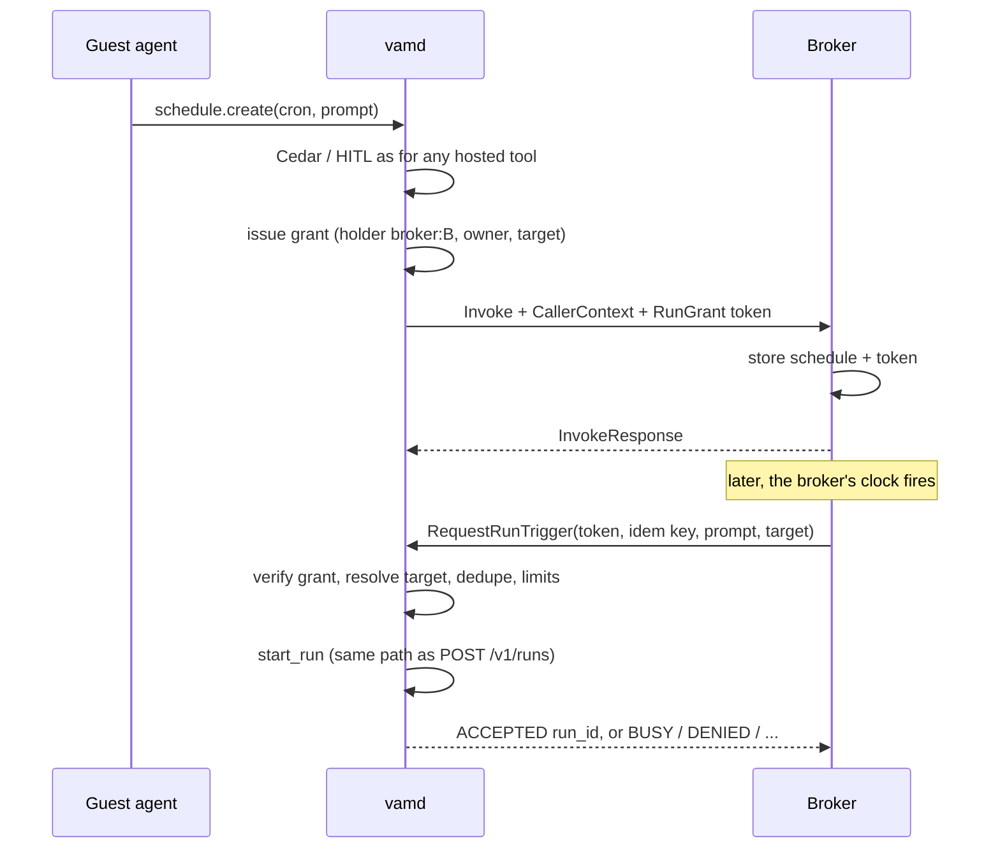

# Broker-triggered runs: brokers ask, vamd starts

**Status:** Proposed; amended 2026-10-15 (task waits and resume delivery, E5 slice); amended 2026-10-29 (plan of record for the E5 getting-started slice: two phases, see "Phases (E5 getting-started slice)")
**Date:** 2026-10-09
**Owner:** maintainer
**Repos:** `squrell-inc/VAM`
**Wire contract and user-facing explanation:**
`docs/src/content/docs/hosted/triggered-runs.md` (this doc does not repeat
the proto sketches).

## Decision record

**Context.** HSP only runs one way today: `vamd` dials brokers over UDS
(`crates/vam-orchestrator/src/hsp.rs`) for `Invoke` and lifecycle hooks.
Runs start only through `POST /v1/runs` (`api/mod.rs::create_run`), which is
welded to the HTTP `AuthContext`. A broker that watches a clock, a chat
channel, or a job queue has no safe way to start a run. The obvious shortcut —
the broker sends back the `CallerContext` it saw on `Invoke` and `vamd` runs
"as" that user — lets any approved broker start runs as any user.

**Decision.** Brokers own scheduling. `vamd` owns identity and run start.

- When an approved tool (e.g. `schedule.create`) is invoked, `vamd` issues a
  **run grant**: a Credential (`design/vam-apps-spaces.md`, Credentials) with holder
  `broker:<id>`, stored hashed like an API key. The broker keeps the token.
- Later the broker calls a new reverse RPC, `RequestRunTrigger`, with the
  token, an idempotency key, a prompt, and a target. `vamd` verifies the grant
  and starts the run through the same `start_run` path as `POST /v1/runs`.
- `vamd` never stores schedules and never runs tickers.

> Brokers decide when. vamd decides who and whether.

## Audience and positioning

The first consumer is the team's scheduler broker ("summarise my Jira board
every day at 6 PM"). The contract is neutral so the same path serves event
brokers later. Broker development itself is deferred; this design ships the
`vamd` side and a Rust test broker.

## What we are building

1. **Contract.** `RunRequestPermission` in the capability manifest,
   `RunGrant` on `InvokeRequest`, and a `HostedTriggerGateway` service served
   by `vamd`.
2. **Shared `start_run`.** Run creation callable without HTTP, including the
   playbook admission path.
3. **Grant issuance.** Grants issued only for operator-approved tools, never
   inside a broker-started run.
4. **Reverse gateway.** A UDS listener in `vamd` that authenticates the calling
   broker, runs the checklist, and returns a typed outcome.

## Why

- Watchers need vendor SDKs and credentials; that is what HSP brokers are for.
- Identity must stay a host decision (zero-trust boundary, AGENTS.md §4).
- Credentials stored as hashes are already a solved, reviewed pattern in
  `keys.rs`; grants reuse it instead of adding signing keys.

## What we are not building

- Cron tickers, schedule storage, or misfire handling in `vamd`.
- Brokers holding a `runs:write` API key and calling `POST /v1/runs`.
- Brokers asserting `user_id`, agent, or owner at fire time.
- Arbitrary `RunSpec` from a broker.
- A `vamd` queue for busy targets.
- Any product broker (scheduler, Slack). Deferred.
- Chat UI changes (separate repo).

## Amendment 2026-10-15: waits that belong to a task (E5 slice)

Confirmed by the owner with `design/agent-runtime.md` Part IX. This design
becomes the base of **E5's getting-started slice**, built right after E10
Phase 6. Changes to the locked table below:

1. **Scheduling.** Brokers still own standing schedules, tickers, cron and
   misfire. `vamd` stores no standing schedules. It **does** hold
   deadlines for waits that belong to a task (`wait_until`, the deadline
   of `wait_for`), as it already does for approvals, gate timeouts,
   keep-warm and active duration.
2. **Resume delivery (new).** Besides `RequestRunTrigger` (start a run),
   the gateway gains `DeliverEvent`: a broker delivers an event to a
   **waiting task** using a **resume grant**. A resume grant covers one
   task and one wait, lives in the same Credential store as run grants,
   is issued when the guest calls `wait_for` (after Cedar), and is revoked
   when the wait resolves or the task ends. `vamd` dedupes by event ID and
   puts the event into the task's inbox.
3. **Busy target.** A trigger or event for a thread with a running or
   parked task goes to that task's inbox (steer or queue), not `BUSY`.
   This answers open question 3. `BUSY` remains for capacity.
4. **Deferred → in scope.** "Resume / continuation for long-running
   external jobs" moves from Deferred into the E5 slice.
5. **Product brokers in the E5 slice:** `vam.schedule` (the reference
   scheduler broker, previously deferred) and `vam.github` (first event
   source). Slack and email delivery (`vam.notify`) follow in E5's later
   stories.
6. **Dependency.** Grants need Credentials from `vam-apps-spaces.md`
   AS-1.1 and AS-1.2, which are not built. They are part of the E5 slice.

Everything else in the table below stands: identity only from the grant,
the loop guard, one `start_run`, and target narrowing.

## Amendment 2026-10-29: plan of record for "work outside chat" (E5 getting-started slice)

Written by a design session against `main` (E10 Phase 3, E12
Phase 1 and hotfix merged). It turns this design and
`design/vam-apps-spaces.md` into two buildable phases (§ "Phases (E5
getting-started slice)" at the end of this file) and the new
`design/schedule-broker.md`. Where `main` contradicts an earlier section of
this doc, `main` is the fact and this amendment wins. Locked rows it touches
are listed in §2 as proposals for the owner; nothing in the locked table is
edited by this amendment.

**Approved by the owner 2026-10-29:** both phases; proposals P1 (the grant
binds the whole run request) and P2 (Space and thread ids without Apps)
accepted, so the two locked rows they amend now read as §2 states; the five
defaults in §7 confirmed. The API-key randomness finding (`keys.rs:182-189`,
time, pid and a counter, not a CSPRNG) is fixed as a separate hotfix before
Phase 1 mints its first grant.

### 1. What `main` has today

| Piece this design needs | On `main` | Where |
| --- | --- | --- |
| Shared, non-HTTP run start (`start_run`, TR-1.1) | **No.** Run creation lives in the HTTP handler `create_run`. The one non-HTTP caller, the queue starter, rebuilds an `AuthContext` from a stored caller and calls the handler itself | `crates/vam-orchestrator/src/api/mod.rs:1205-1470`; `api/queue.rs:72-200` (`start_queued` → `super::create_run` at `:177`) |
| A stored caller that starts a run later | **Yes**: `QueuedCaller {key_id, name, principal, scopes, owner_user_id, role, session_token}`; `to_auth` re-reads the user's role, refuses a deactivated user and a revoked key | `crates/vam-orchestrator/src/inbox.rs:104-185` |
| Busy workspace → queue | **Yes** (owner decision D, E10 Phase 3): another thread, or `inboxMode: QUEUE`, becomes a PENDING run started when the workspace is free; same thread steers; a finalizing or stopping run keeps the retryable 409 | `api/inbox.rs:333-438`; `api/queue.rs:41-108` |
| … for a run that names a playbook | **No.** `admit` refuses any queued message with a playbook ref, inline agent, or an input other than `prompt`/`model` | `api/inbox.rs:379-387` |
| Model resolution independent of the caller | **Yes**: `resolve_run_model` with node allowlist and default, recorded as `model.resolved` | `api/mod.rs:1345-1360`; `allowed_models.rs:371` |
| Who asked and from where | **Yes** (E12 Phase 1): `run_requests (run_id, requested_by_user_id, surface, created_at, decision_write_failures)`, written as evidence only; surfaces `api`, `cli`, `app`, `system`; receipt `ReceiptRequester {user = 1, surface = 2}` | `run_facts.rs:14-31, 184-190, 255-276`; `api/mod.rs:1452-1459`; `proto/vam/v1/receipt.proto:71-74` |
| Credential columns (`holder`, `expires_at`, …; AS-1.1) | **No.** `api_keys (key_id, name, sha256_secret, principal, scopes, created_at, last_used_at, revoked_at)` plus `owner_user_id` | `keys.rs:142-152, 199-208` |
| CSPRNG key secrets | **No.** `mint_api_key_secret` is `time ^ pid ^ counter` (64 bits) | `keys.rs:175-189` |
| `RunRequestPermission`, `RunGrant`, gateway | **No.** `CapabilityManifest` ends at `identity_requirement = 9`, `InvokeRequest` at `caller_context = 8`: fields 10 and 9 are free | `proto/vam/v1/hosted_services.proto:85-95, 193-202` |
| Where a grant would be issued | `invoke_hosted_tool`: approval and identity checked, `InvokeRequest` built, secrets resolved per tool, then the broker is dialled | `host_tools.rs:2830-2910` |
| Brokers registered by the operator | `PUT /v1/hosted/brokers` (manifest + Unix path); approvals in `hsp_broker_approvals` | `api/mod.rs:2158`; `hsp_store.rs:44-52` |
| First-party broker shape | `brokers/vam-web`: own crate and binary, `vam-spec` + `tonic`, UDS 0600 | `brokers/vam-web/Cargo.toml`; `src/serve.rs:18-44` |
| A Rust test broker | `hsp-echo-broker` (in-repo echo `HostedBroker`) | `crates/vam-orchestrator/src/hsp_echo.rs`; `src/bin/hsp-echo-broker.rs` |
| Space or thread ids | **No.** Workspace id `{owner}--{agent_key}--{name}` (legacy `{owner}--{name}` kept for its bound agent); a thread is a name, stored owner-prefixed, used as its directory | `run_context.rs:128-165`; `vam-storage/src/owner_prefix.rs:68-124`; `vam_dir.rs:144-157, 210-231, 359-389` |

### 2. What changes in this design, and the locked rows it touches

1. **The grant binds the whole run request, not only a target.** At
   issuance `vamd` reads a `run` object from the tool's arguments
   (`RunGrantRequest`, §3), resolves it to ids (agent, Space, thread,
   playbook) and stores it on the grant with the message, inputs, on-busy
   choice and expiry. A fire carries only a key, a time, a label and a kind:
   **the broker decides when; the grant decides who, what and where.** The
   user approves exactly what will run.
   - **Proposal P1 (locked row "Target shape", owner to confirm).** Was:
     "Same `RunTarget { app, space_ref, thread, thread_mode }` as
     `vam-apps-spaces.md`" on the fire request. Proposed: the target is
     resolved once, at issuance, to `space_id` and `thread_id` and bound in
     the grant; `RequestRunTriggerRequest` has no target and no prompt. The
     rule "a request may only narrow" holds trivially (it cannot name one).
     `RunTarget` on `CreateRunRequest` (AS-0.1) is not part of E5.
2. **Busy → queue, per grant** (refines the 2026-10-15 amendment item 3,
   which already replaced the locked "Busy target" row). A fire on a
   workspace with a live or parked task is queued through the inbox exactly
   as a run for another thread is today (`api/inbox.rs:391-409`), when the
   grant's `on_busy` is `QUEUE` (default). It is **always a queued task,
   never a steer**: a schedule never injects text into a conversation a
   person is having. `SKIP` answers `BUSY` and the broker records a skip. At
   most one queued fire per grant; a later one answers `BUSY
   ALREADY_QUEUED`. A queued fire carries `not_after` and ends `EXPIRED` if
   it has not started by then. One live task per workspace stays (E10
   locked decision 12).
3. **Loop guard, stricter reading** (agrees with the locked row "No grant
   is issued inside a broker-started run"). Inside a run a trigger started,
   `vamd` refuses the Invoke of any tool the manifest lists in
   `loop_guarded_tools` (a superset of `grant_tools`), so no grant is issued
   and no run-now fires from a triggered run. The guard reads the
   authoritative `runs.source`, never the evidence table.
4. **Grant issuance** (agrees with the locked row): only for a tool in the
   approved `grant_tools`, only after the permission decision, and only when
   the arguments carry `run`. If the broker's Invoke then fails, `vamd`
   revokes the grant it just minted.
5. **`vamd` stores no standing schedules** (locked "Scheduling" row and E10
   decision 16): the grant row holds an approved run request and an expiry,
   no time of day, no recurrence and no clock. The queued fire's
   `not_after` is a deadline of a task, which the 2026-10-15 amendment
   item 1 already allows.
6. **Field numbers** (locked row): `CapabilityManifest.run_request_permission
   = 10` and `InvokeRequest.run_grant = 9` are still free on `main`.
7. **Broker development** (locked row "Deferred. Rust test broker only",
   already changed by the 2026-10-15 amendment item 5): Phase 1 ships the
   test broker, Phase 2 ships `vam.schedule` (`design/schedule-broker.md`).

### 3. Contract

All in `proto/vam/v1/hosted_services.proto` unless named. Additive only.
The Starlight page `hosted/triggered-runs.md` is rewritten to match this
section in WO-1.1 (it still lists "a `vamd`-side queue for busy workspaces"
as a non-goal and sketches a fire-time `RunTarget`; both are superseded).

```protobuf
// CapabilityManifest
RunRequestPermission run_request_permission = 10;

message RunRequestPermission {
  repeated string grant_tools = 1;         // ⊆ tools. Their Invoke may carry a RunGrant.
  int32 max_requests_per_minute = 2;       // per broker, enforced by the gateway
  int32 max_requests_per_day = 3;
  repeated string loop_guarded_tools = 4;  // ⊆ tools, ⊇ grant_tools. Refused inside a triggered run.
  string surface = 5;                      // receipt surface, [a-z]{3,16}; not cli|app|api|system
  int32 max_active_grants_per_user = 6;    // per owner and broker; 0 = 50
}

// InvokeRequest
RunGrant run_grant = 9;

message RunGrant {
  string token = 1;                        // vam_rg_<grant_id>.<secret>; returned once, to this broker
  string grant_id = 2;                     // rg_<26 chars base32>, CSPRNG
  google.protobuf.Timestamp issued_at = 3;
  google.protobuf.Timestamp expires_at = 4;
  GrantTarget target = 5;                  // what vamd bound, for the broker's display
}

message GrantTarget {
  string agent_urn = 1;
  string space_id = 2;
  string space_name = 3;
  string thread_id = 4;
  string thread_name = 5;
  OnBusy on_busy = 6;
  ResourceRef playbook_ref = 7;
  string request_digest = 8;               // "sha256:<hex>" of the bound request (canonical JSON)
}

// What a grant tool asks to run. vamd reads it from the tool arguments at key "run".
message RunGrantRequest {
  string agent_urn = 1;                    // empty = the calling agent
  PlaceChoice workspace = 2;               // empty = SAME
  PlaceChoice thread = 3;                  // empty = NEW
  string message = 4;                      // ≤ 32 KiB; required unless playbook_ref
  ResourceRef playbook_ref = 5;            // explicit start (agent-runtime decision 18)
  google.protobuf.Struct inputs = 6;       // checked against the playbook's input_schema
  OnBusy on_busy = 7;                      // empty = QUEUE
  google.protobuf.Timestamp expires_at = 8;// empty = now + 90 d; capped at now + 365 d
}

message PlaceChoice {
  PlaceMode mode = 1;
  string id = 2;                           // with ID: sp_… or th_…
  string name = 3;                         // with NEW: the label; else generated
}
enum PlaceMode { PLACE_MODE_UNSPECIFIED = 0; PLACE_MODE_SAME = 1; PLACE_MODE_NEW = 2; PLACE_MODE_ID = 3; }
enum OnBusy { ON_BUSY_UNSPECIFIED = 0; ON_BUSY_QUEUE = 1; ON_BUSY_SKIP = 2; }

// CallerContext (host-stamped; see vam-apps-spaces.md amendment §4)
string space_id = 8;
string thread_id = 9;
string run_source = 10;                    // "" for a person; "broker:<id>" for a triggered run

// Served by vamd, one Unix socket per approved broker (§5).
service HostedTriggerGateway {
  rpc RequestRunTrigger(RequestRunTriggerRequest) returns (RequestRunTriggerResponse);
  rpc RevokeRunGrant(RevokeRunGrantRequest) returns (RevokeRunGrantResponse);
}

enum FireKind { FIRE_KIND_UNSPECIFIED = 0; FIRE_KIND_SCHEDULED = 1; FIRE_KIND_RUN_NOW = 2; FIRE_KIND_EVENT = 3; }

message RequestRunTriggerRequest {
  string run_grant = 1;
  string idempotency_key = 2;              // ≤ 128 chars; the same on every retry of one fire
  google.protobuf.Timestamp fire_at = 3;   // nominal time
  string trigger_ref = 4;                  // broker's label (a schedule id); pinned on the first accepted fire
  FireKind kind = 5;
  google.protobuf.Timestamp not_after = 6; // a queued fire not started by then ends EXPIRED
  TraceContext trace_context = 7;
  reserved 8;                              // event_context: event brokers, fenced (E5 later phase)
}

enum RunTriggerOutcome {
  RUN_TRIGGER_OUTCOME_UNSPECIFIED = 0;
  RUN_TRIGGER_OUTCOME_ACCEPTED = 1;        // run started; run_id set
  RUN_TRIGGER_OUTCOME_DUPLICATE = 2;       // key already used; that run_id set
  RUN_TRIGGER_OUTCOME_BUSY = 3;            // see busy_reason
  RUN_TRIGGER_OUTCOME_RATE_LIMITED = 4;    // retry_after_ms set
  RUN_TRIGGER_OUTCOME_UNAVAILABLE = 5;     // admission full or draining; retry_after_ms set
  RUN_TRIGGER_OUTCOME_DENIED = 6;          // see deny_reason; do not retry
  RUN_TRIGGER_OUTCOME_QUEUED = 7;          // queued behind the live task; run_id of the queued run
}
enum BusyReason {
  BUSY_REASON_UNSPECIFIED = 0;
  BUSY_REASON_ACTIVE_RUN = 1;              // the task is finalizing or stopping; retry_after_ms set
  BUSY_REASON_SKIPPED = 2;                 // on_busy SKIP and a live or parked task holds the workspace
  BUSY_REASON_ALREADY_QUEUED = 3;          // this grant already has a queued fire
}
enum DenyReason {
  DENY_REASON_UNSPECIFIED = 0;
  DENY_REASON_REVOKED = 1;
  DENY_REASON_EXPIRED = 2;
  DENY_REASON_WRONG_BROKER = 3;
  DENY_REASON_TOOL_NOT_APPROVED = 4;
  DENY_REASON_OWNER_DISABLED = 5;
  DENY_REASON_AGENT_UNAVAILABLE = 6;
  DENY_REASON_TARGET_GONE = 7;
  DENY_REASON_INVALID_REQUEST = 8;         // unknown grant, bad key, inputs no longer valid
  DENY_REASON_NOT_PERMITTED = 9;           // tier, approval or run_request_permission missing
  DENY_REASON_TRIGGER_REF_MISMATCH = 10;
}

message RequestRunTriggerResponse {
  RunTriggerOutcome outcome = 1;
  ResourceId run_id = 2;
  string space_id = 3;
  string thread_id = 4;
  int32 retry_after_ms = 5;
  BusyReason busy_reason = 6;
  DenyReason deny_reason = 7;
  ErrorStatus error = 8;                   // VAM-composed detail; never broker text
}

message RevokeRunGrantRequest { string run_grant = 1; }   // proves possession
message RevokeRunGrantResponse { ErrorStatus error = 1; }
```

In `proto/vam/v1/workflow.proto` (ids: `vam-apps-spaces.md` amendment §4):

```protobuf
// RunSpec
string space_id = 12;                      // wins over workspace_ref_uri when set; must agree if both
string thread_id = 13;                     // wins over thread_ref when set; must agree if both

// RunStatus (19 is waiting_for)
string space_id = 20;
string thread_id = 21;
RunSource source = 22;

message RunSource {
  string kind = 1;                         // "person" | "trigger"
  string broker_id = 2;
  string grant_id = 3;
  string trigger_ref = 4;
  google.protobuf.Timestamp fire_at = 5;
  string fire_kind = 6;                    // "scheduled" | "run_now"
}
```

In `proto/vam/v1/receipt.proto` (owned by the E12 lane, `design/run-receipt.md`;
this is a request to that lane, additive, verified on emitted JSON so older
verifiers are unaffected):

```protobuf
// ReceiptRequester
ReceiptTrigger trigger = 3;                // absent for a person

message ReceiptTrigger {
  string broker_id = 1;
  string grant_id = 2;
  string trigger_ref = 3;
  int64 fire_at_ms = 4;
  string fire_kind = 5;
}
```

Validation (`vam-spec/src/validation.rs`, `hsp_registry.rs`): `grant_tools`
⊆ `tools`; `loop_guarded_tools` ⊆ `tools` and ⊇ `grant_tools`; `surface`
charset and reserved names; `TRUST_TIER_THIRD_PARTY` may not declare
`run_request_permission`; a presented manifest may not exceed the approved
tools or limits (the subset gate `secret_bindings` already uses).

### 4. The grant: issuance and storage

**Storage** (one Credential type, `design/vam-apps-spaces.md` amendment §2):
a row in `api_keys` with

| Column | Grant value |
| --- | --- |
| `key_id` | `rg_…` (the grant id) |
| `sha256_secret` | SHA-256 of the secret part; the token is never stored |
| `name` | `grant: <tool> (<broker>)` |
| `principal` | the owner's principal, from the source run (`runs.owner_principal`) |
| `scopes` | `runs:start` |
| `owner_user_id` | the source run's owner |
| `holder` (new) | `broker:<id>` |
| `target_kind`, `target_id` (new) | `space`, `sp_…` |
| `constraints_json` (new) | the bound request: `{agent_urn, space_id, thread_id, message, playbook_ref, inputs, on_busy}` |
| `issued_via` (new) | `invoke` |
| `source_run_id`, `tool_name` (new) | provenance |
| `external_ref` (new) | the broker's `trigger_ref`, pinned on the first accepted fire |
| `expires_at` (new) | always set for grants |

Secrets come from `rand::rngs::OsRng` (32 bytes, base64url), never from
`mint_api_key_secret` (`keys.rs:175-189`, not a CSPRNG; see the security
note at the end of this amendment).

**Issuance** in `invoke_hosted_tool` (`host_tools.rs:2830`), after the
approval and identity checks (`:2838-2849`) and before preflight:

1. Loop guard: if the tool is in `loop_guarded_tools` and the calling run's
   `runs.source` starts with `broker:`, refuse with a host error ("this tool
   cannot be used in a run a trigger started").
2. If the tool is in `grant_tools` and `args.run` is present: decode it as
   `RunGrantRequest` (JSON mapping, unknown fields refused).
3. Resolve and validate (rules in `design/schedule-broker.md`, "The
   tools"): the agent (the calling agent, or one the owner may run,
   `catalog_resolve.rs:43`); the Space (`SAME` = the calling run's Space;
   `NEW` = a Space row created now; `ID` = an owned Space bound to that
   agent); the thread (`SAME` only with workspace `SAME`; `NEW` = a thread
   row created now, its directory written at its first run; `ID` = a thread
   of that Space); the playbook (attached or allowed for the agent) and
   inputs against its `input_schema`; message size; expiry and cap; at most
   `max_active_grants_per_user` live grants. A failure is a typed tool error
   the agent can repair; nothing is minted.
4. Mint the token, insert the row, set `InvokeRequest.run_grant`.
5. Invoke the broker. If the call fails or returns a tool error, revoke the
   grant in the same handler.

**Listing and revoking** (AS-1.3 for grants): `GET /v1/keys?holder=broker`
and `DELETE /v1/keys/{id}` (existing routes, `api/mod.rs:102-103`),
owner-scoped; `vam keys list --grants` shows holder, target labels, bound
message preview, `issued_via`, `expires_at`, `last_used_at`; `vam keys revoke
<id>`. HTTP bearer auth refuses any row whose `holder` is not `http`
(`check_credential`, AS-1.2).

### 5. The gateway

**Socket and caller auth (answers open question 1).** One Unix socket per
approved broker that declares `run_request_permission`:
`<state_dir>/hsp/gateway/<broker_id>.sock`, directory 0700, socket 0600 (or
0660 with the group the operator names). `vamd` opens it when the approval is
enabled and closes it when the approval is disabled or removed. **The
calling broker is the socket the call arrived on**; no broker id is ever
read from the request. When the approval records `peer_uid`, `vamd` also
checks `SO_PEERCRED` and refuses another uid (defence in depth on hosts where
brokers run as their own users). `hsp_broker_approvals` gains
`gateway_socket` and `peer_uid`; `GET /v1/hosted/brokers/{id}` shows the path;
the broker takes it as `--gateway-socket`. Never TCP, never reachable from
the guest (the guest has vsock only).

Rejected: one shared socket with `SO_PEERCRED` mapping only (every broker
runs as the same user on a dev host and on Lima, so the mapping identifies
nothing there); a per-broker bearer issued at registration (one more secret
to store, rotate and leak, for what a socket path already gives).

**Checklist → outcome**, in order:

| # | Check | Outcome on failure |
| --- | --- | --- |
| 1 | Socket → broker; approval enabled; tier core, first-party or operator; `run_request_permission` present; `SO_PEERCRED` if configured | `DENIED NOT_PERMITTED` |
| 2 | Token parses; row found; secret hash matches (constant time) | `DENIED INVALID_REQUEST` |
| 3 | `holder == broker:<this socket's broker>` | `DENIED WRONG_BROKER` |
| 4 | Not revoked; not expired | `DENIED REVOKED` / `EXPIRED` |
| 5 | `tool_name` still in the approved `grant_tools` | `DENIED TOOL_NOT_APPROVED` |
| 6 | Owner exists and is active (`users::reject_deactivated_user`) | `DENIED OWNER_DISABLED` |
| 7 | `trigger_ref` equals the pinned `external_ref` (when pinned) | `DENIED TRIGGER_REF_MISMATCH` |
| 8 | Per-broker rate limit (in-memory buckets; reset on restart) | `RATE_LIMITED` |
| 9 | Dedupe: spec key `hsp:<broker_id>:<idempotency_key>` in the owner's run keys (`catalog.rs:1831`, covers started and queued runs) | `DUPLICATE` with that run |
| 10 | Space and thread rows exist and belong to the owner | `DENIED TARGET_GONE` |
| 11 | Workspace busy? `SKIP` → `BUSY SKIPPED`; a queued fire of this grant pending → `BUSY ALREADY_QUEUED`; finalizing or stopping → `BUSY ACTIVE_RUN` with `retry_after_ms = 2000`; else queue | `QUEUED` |
| 12 | Start through the shared path (§6): agent load for the owner, secret admission, model resolution, playbook admission and inputs re-checked, capacity | `DENIED AGENT_UNAVAILABLE` / `INVALID_REQUEST`, `UNAVAILABLE` |
| 13 | Run started; `last_used_at` and `external_ref` written | `ACCEPTED` |

Every outcome increments `vam_hsp_trigger_total{broker_id, outcome}`; an
accepted or queued fire writes `trigger.fired` to that run's outbox with the
grant id, trigger ref and fire kind. Refusals are logged at info with the
grant id and reason, never the token.

**`RevokeRunGrant`** proves possession (steps 1 to 3), sets `revoked_at`,
and discards a pending queued fire of that grant. Idempotent.

**Queued fires.** The queued run stores its full request (`QueuedStart`,
`inbox.rs:186-193`) with the caller extended by `source`, `credential_id`
and `not_after` (serde defaults, so rows written today still read).
`run_inbox` gains `credential_id` for the one-queued-per-grant lookup. At
start the queue starter re-checks the grant (revoked or expired → the
queued run fails "the schedule's grant was revoked"), and past `not_after`
it ends the run `EXPIRED` (RunState 8). `admit` lets a triggered queued run
keep its playbook and inputs; the refusal at `api/inbox.rs:379-387` stays for
messages from people.

### 6. Run start, run source, receipt

- **`start_run` (TR-1.1, unchanged in intent).** Extract run creation from
  `create_run` into `run_start::start_run(state, RunCaller, CreateRunRequest)`
  where `RunCaller { owner_user_id, principal, role, scopes, credential_id,
  source: Person { surface } | Trigger { broker_id, grant_id, trigger_ref,
  fire_at, fire_kind, surface } }`. The HTTP handler keeps auth, the PDP
  check (`CreateRun`, `runs:write`) and the idempotency header; the queue
  starter (`api/queue.rs:177`) and the gateway call `start_run` directly. No
  copy of `create_run`.
- **`runs`** gains `source TEXT` (NULL = a person, `broker:<id>`) and
  `credential_id TEXT`, written with `persist_run_spec_with_owner`
  (`catalog.rs:1769`) in the same statement: the loop guard and the queue
  starter read these, never `run_requests`.
- **`run_requests`** gains `broker_id`, `grant_id`, `trigger_ref`, `fire_at`,
  `fire_kind` (nullable); `surface` is the manifest's
  `run_request_permission.surface` (`schedule` for `vam.schedule`). Evidence
  only, as today.
- **`RunStatus.source`** (22) and the receipt's `ReceiptRequester.trigger`
  (3) are built from those rows. The CLI receipt line: "requested by alice,
  surface schedule — schedule `sch_…` via grant `rg_…` (vam.schedule), fire
  time 2026-10-30T17:00:00Z".
- **`CallerContext.run_source`** (10) is stamped from `runs.source`
  (`caller_context.rs:18-80`), so a broker can also see that a call comes
  from a triggered run.

### 7. Open questions, resolved with a default each

| # | Question | Default |
| --- | --- | --- |
| 1 | Gateway caller auth | One socket per approved broker; identity is the socket; `SO_PEERCRED` when `peer_uid` is set (§5). |
| 2 | Grant expiry | Always set. Default 90 days, cap 365; a `once` grant at most its fire time + 24 h. No silent renewal on use: renewal is a re-bind the user approves. `vamd` emits `grant.expiring` 7 days ahead (outbox of the grant's last run; `vam.notify` delivers it once E12 Phase 2 lands). |
| 3 | Busy and parked targets | Queue through the inbox (default `on_busy QUEUE`), always as a queued task, never a steer; one queued fire per grant; `not_after`. `SKIP` answers `BUSY SKIPPED`. Parked runs queue behind like any live task. |
| 4 | Triggered playbook runs | Yes, in E5 Phase 1: `RunGrantRequest.playbook_ref` and `inputs`, checked at issuance and at every fire. The launch demo is a scheduled `close-prep` run. |
| 5 | HITL on schedule creation | No special rule. Creation tools are `MUTABLE_EXTERNAL`, so `bySideEffect` asks by default (`vam-security/src/permissions.rs:496-516`); "always allow" works as for any tool, because the grant binds exactly what was approved and every triggered run meets the same policy (its own asks park). |
| 6 | Target for a new workspace | `NEW` creates one Space at issuance, dedicated to the grant, labelled from `workspace.name` or `schedule-<6>`, workspace id by today's scheme `{owner}--{agent_key}--{label}`, materialised and bound to the agent at its first run. Same for `NEW` thread. Not one per fire (no retention in 0.1.0). |
| 7 | A fire on a busy workspace | Queue through the inbox, as a run for another thread already does (owner's recommendation, taken). |
| 8 | Who may be the target agent | Default the calling agent; another agent only if the owner may run it today and the workspace is `NEW` or bound to it. This is a separate task as the owner, not delegation (E10 decision 4 untouched). |

### 8. Not in these two phases

- **Resume grants, `DeliverEvent`, `wait_for`, `vam.github`** (2026-10-15
  amendment items 2, 4, 5). They reuse Phase 1's credential kind, gateway
  socket and caller auth, and add one RPC. Planned as a later E5 phase after
  E10 Phase 5's `wait_until`. B2's `pr-process` task waits on it
  (`design/launch-0.1.0.md` §4 row 11).
- **`vam.notify`** (Slack, email): E12 Phase 2. Deciding a gate from Slack
  is a reverse call too; E12 Phase 2 reuses Phase 1's gateway socket and
  credential checks for it.
- **Apps, shared Spaces, Space retention, App authority** (`vam-apps-spaces.md`
  Phases 2, 4–6): cut from 0.1.0 (`launch-0.1.0.md` §2). Phase 1 builds only
  the Credential columns and the Space and thread ids.

**Security note found while verifying.** API key secrets on `main` come from
`time ^ pid ^ counter` (`keys.rs:175-189`), 64 bits that are guessable
given the mint time. Grants never use that function. Fixing it for API keys
is a separate P1 item (security floor, `launch-0.1.0.md` §3), not part of
this slice.

## Decision summary (locked)

| Topic | Decision |
| --- | --- |
| Scheduling | Broker owns storage, tickers, cron, misfire, firing. `vamd` has no ticker and no schedule table. |
| Registration | Through broker-exported tools (`schedule.create`, …). |
| Identity | Only from the `vamd`-stored grant. Broker never asserts it. |
| Grant storage | A Credential (`vam-apps-spaces.md`): record + SHA-256 of secret in `vamd`, token in the broker. Per-grant list and revoke. |
| Grant issuance | Only on `Invoke` of a tool in the approved `run_request_permission.grant_tools`. |
| Loop guard | No grant is issued inside a broker-started run. |
| Busy target | `BUSY` outcome with `retry_after_ms`; broker retries with the same idempotency key. |
| Run start | One `start_run` shared with `POST /v1/runs`. |
| Target shape | Same `RunTarget { app, space_ref, thread, thread_mode }` as `vam-apps-spaces.md`, Starting a run. |
| Field numbers | `CapabilityManifest.run_request_permission = 10` (9 is `identity_requirement`); `InvokeRequest.run_grant = 9`. |
| Broker development | Deferred. Rust test broker only. |

## Target model

### Roles

**vamd: the authority**
- Issues grants on approved tool calls; stores them hashed.
- Serves `HostedTriggerGateway`; authenticates the calling broker.
- Verifies grants, resolves the target, dedupes, rate-limits, starts runs.
- Lets users list and revoke grants.

**Broker: the clock**
- Stores schedules (or subscriptions) and their grant tokens.
- Fires, retries on `BUSY` / `RATE_LIMITED` / `UNAVAILABLE`, drops on
  `DENIED`.
- Calls `RevokeRunGrant` when it deletes a schedule.

**Guest agent**
- Calls broker tools like any hosted tool. Never sees grant tokens.

### Sequence



### Gateway checklist (summary)

Broker identity → grant (hash, holder, not revoked/expired, tool still
approved, owner enabled) → dedupe (`hsp:<broker>:<key>` in the owner's run
idempotency space) → per-broker rate limit → target resolution (request may
only narrow the grant) → busy check → catalog and policy for the owner →
admission → `start_run`. Full detail in the Starlight page.

## Data model (conceptual)

- **Manifest:** `RunRequestPermission { grant_tools[], max_requests_per_minute,
  max_requests_per_day }`, approved with the same subset gate as
  `secret_bindings`.
- **Grant:** a row in the Credential store (`api_keys` extended; see
  `vam-apps-spaces.md` AS-1.1) with `holder = broker:<id>`,
  `issued_via = invoke`, `source_run_id`, `tool_name`, target, captured
  thread.
- **Run:** `source` (`api` | `broker:<id>`), `credential_id`,
  `broker_trigger_ref`, `fire_at`; exposed on `RunStatus`.

## Phases

> **Superseded for planning (2026-10-29)** by "Phases (E5 getting-started
> slice)" at the end of this file, which maps every TR item below. Kept as the
> item-level reasoning.

IDs (`TR-x.y`) are local and become Linear issues; each must be independently
reviewable.

| Phase | Goal | Depends on |
| --- | --- | --- |
| 0 | Contract frozen | — |
| 1 | Shared `start_run` | — (parallel with 0) |
| 2 | Grants issued on `Invoke` | 0, `vam-apps-spaces` AS-1.1, AS-1.2 |
| 3 | Reverse gateway end to end | 1, 2 |

### Phase 0 — Contract

**Exit:** proto committed and validated; Starlight page matches it;
`cargo test -p vam-spec` passes.

- **TR-0.1 Manifest `RunRequestPermission` and subset gate.** Field 10 on
  `CapabilityManifest`. Validation: `grant_tools` ⊆ exported tools; presented
  manifest may not exceed approved tools or limits; third-party tier may not
  declare it. Files: `proto/vam/v1/hosted_services.proto`,
  `crates/vam-spec/src/validation.rs`,
  `crates/vam-orchestrator/src/hsp_registry.rs`. Tests: `cargo test -p
  vam-spec`, `tests/hsp_manifest.rs`, `tests/hsp_trust.rs`.
- **TR-0.2 Grant and gateway messages.** `RunGrant` (`InvokeRequest` field 9),
  `HostedTriggerGateway` with `RequestRunTrigger` and `RevokeRunGrant`,
  `RunTarget`, `ThreadMode`, `RunTriggerOutcome`, `busy_reason`. Client and
  server codegen. Files: `hosted_services.proto`, `crates/vam-spec/build.rs`,
  baseline fixtures, `crates/vam-spec/examples/generate_baseline.rs`.
  Blocked by TR-0.1.
- **TR-0.3 Docs.** Starlight `hosted/triggered-runs.md` and
  `hosted/protocol.md` match the committed proto. Blocked by TR-0.2.

### Phase 1 — Shared `start_run`

**Exit:** `POST /v1/runs` behaviour unchanged (existing API and hermetic tests
pass); `start_run` callable from a non-HTTP caller in a unit test.

- **TR-1.1 Extract `start_run`.** Move run creation out of
  `api::create_run` into `start_run(caller { owner_user_id, principal, source
  }, spec, inline_agent, inline_playbook)`, including playbook admission
  (`ensure_playbook_ref`, `prepare_playbook_admission`,
  `commit_playbook_admission`), the parked-run workspace reservation check
  (PB-1.5), and `OnRequest` hooks. HTTP handler keeps auth and idempotency
  header only. Files: `api/mod.rs`, new
  `crates/vam-orchestrator/src/run_start.rs`, `run_context.rs`. Tests:
  `tests/api_tests.rs`, `tests/hermetic_tests.rs` unchanged.
- **TR-1.2 Typed start errors.** Distinct errors for duplicate idempotency,
  active run on the workspace (`AgentRunning`), workspace reserved by a
  parked run (existing `WorkspaceReserved`, PB-1.5), workspace/agent
  mismatch, admission full. Files:
  `error.rs`, `run_start.rs`. Blocked by TR-1.1.
- **TR-1.3 Run source metadata.** `source`, `credential_id`,
  `broker_trigger_ref`, `fire_at` on the run; on `RunStatus`. Files:
  `workflow.rs` (`runs` table), `proto/vam/v1/workflow.proto` (`RunStatus`),
  `api/mod.rs::build_run_status`. Blocked by TR-1.1.

### Phase 2 — Grants on `Invoke`

**Exit:** a grant is issued only for approved grant tools, stored hashed,
shown once, and never issued inside a broker-started run.

- **TR-2.1 Issue grant.** In `invoke_hosted_tool`, for tools in the approved
  `grant_tools`, create a Credential (holder `broker:<id>`, `issued_via
  invoke`, owner and target from the host-stamped `CallerContext`) and attach
  `RunGrant`. Files: `host_tools.rs`, `keys.rs`. Blocked by TR-0.2, AS-1.1.
- **TR-2.2 Loop guard.** Skip issuance when the current run's `source` is
  `broker:*`. Files: `host_tools.rs`. Blocked by TR-1.3, TR-2.1.
- **TR-2.3 Tests.** Issue only for grant tools; secret never persisted in
  plain text; not issued in broker runs; user can list and revoke via the
  AS-1.3 API. Files: `tests/hsp_invoke.rs`. Blocked by TR-2.2.

### Phase 3 — Reverse gateway

**Exit:** with a Rust test broker: Invoke issues a grant → fire → `ACCEPTED`
run as the grant owner; `BUSY`, `DUPLICATE`, `DENIED` (revoked, wrong broker,
widened target), `RATE_LIMITED` all covered; revoked grant stops fires.

- **TR-3.1 Gateway listener and caller auth.** UDS server in `vamd`;
  authenticate the calling broker (decide in the plan: per-broker socket vs
  `SO_PEERCRED` mapping); endpoint discovery per TR-0.2. Files: new
  `hsp_gateway.rs`, `bin/vamd.rs`. Blocked by TR-0.2.
- **TR-3.2 `RequestRunTrigger`.** Checklist above, mapped to outcomes;
  credential checked with AS-1.2; namespaced idempotency; target resolution
  (request → grant → default; App/Space columns used once AS-4.1 lands);
  `start_run`. Files: `hsp_gateway.rs`, `run_start.rs`. Blocked by TR-1.2,
  TR-2.1, TR-3.1.
- **TR-3.3 Per-broker rate limits.** From the approved manifest; typed
  reason. Files: `hsp_gateway.rs`. Blocked by TR-3.2.
- **TR-3.4 `RevokeRunGrant`.** Proves possession; revokes the Credential.
  Blocked by TR-3.1, TR-2.1.
- **TR-3.5 Events.** Outbox `vam.v1.trigger.{fired,busy,denied,rate_limited}`.
  Files: `events.rs`. Blocked by TR-3.2.
- **TR-3.6 Test broker and end-to-end tests.** Files: new
  `tests/hsp_trigger.rs` (test broker in the test, not a product broker).
  Blocked by TR-3.2–TR-3.4.

## Open questions

> All four answered with a default in the amendment of 2026-10-29, §7.

1. **Gateway caller auth:** one socket per approved broker, or one socket plus
   `SO_PEERCRED` uid → broker mapping? Decide when planning TR-3.1.
2. **Grant expiry default:** none, or N days with renewal on use?
3. **Parked runs block a target for days** (playbooks PB-1.5 reservation).
   Draft: `BUSY` carries `busy_reason` (`active_run` | `parked_run`); for
   `parked_run` no `retry_after_ms` is given and the broker decides to skip
   or retry later.
4. **Triggered playbook runs:** should a grant capture a `playbook_ref` and
   the request carry `inputs` validated against its `input_schema`? Gates in
   unattended runs park and notify the owner via `on_paused` (PB-1.8, merged).
   Draft: yes, as a follow-up issue after Phase 3; reserve the request field
   in TR-0.2.

## Deferred

> 2026-10-29: the scheduler broker is no longer deferred (E5 Phase 2,
> `design/schedule-broker.md`, Rust under `brokers/`). Resume / continuation
> moves to a later E5 phase (amendment §8). The rest stays deferred.

- Reference scheduler broker (`examples/hsp-scheduler-ts`): storage, ticker,
  `schedule.create/list/pause/resume/delete`, storage partitioned by
  `CallerContext.user_id`, retry policy, Lima proof.
- Event triggers (Slack), webhook dedupe, echo filters.
- Resume / continuation for long-running external jobs.
- Grants for third-party brokers (needs marketplace VM isolation).
- Slack-style personal account linking (idea only).

## PR base

> 2026-10-29: the base branch is named by the orchestrator when it opens the
> `work-outside-chat` tracker; playbooks and the inbox are on `main`.

`feat/hsp-triggers` cut from `main`. Playbooks Phases 0–3 are merged there, so
TR-1.1 moves the playbook admission and parked-run reservation logic that now
lives in `api::create_run`; nothing in this design waits on playbooks.

## Issue index

Not created yet.

## Implementer constraints

- The broker never asserts identity. Owner, target, and holder come only from
  the stored grant.
- Grant secrets are stored as SHA-256 only; tokens are returned once.
- A request may only narrow the grant's target, never widen it.
- No ticker or schedule table in `vamd`.
- `start_run` is the only run-creation path; do not copy `create_run`.
- Inbound triggers add no guest-visible vsock RPC; the guest uses Port 52 only.
- `hosted_services.proto` already has `HOOK_PHASE_ON_PAUSED = 4` (PB-1.8).
  New fields: `CapabilityManifest` 10, `InvokeRequest` 9 (both currently
  free); re-check before TR-0.x lands.
- Add focused tests per issue; run `cargo test -p vam-spec`,
  `cargo test -p vam-orchestrator`, `cargo check --workspace`, and
  `cargo fmt --all --check`.
- If an issue changes a public contract, update the Starlight page and
  `docs/astro.config.mjs` when pages move.

## Phases (E5 getting-started slice, plan of record 2026-10-29)

Supersedes the TR-0 to TR-3 phase list above for planning; the TR items map
into these two phases (table at the end). Item ids `WO-<phase>.<n>` ("work
outside chat"); the tracker slug the orchestrator opens is
`work-outside-chat`. Each item carries its Decide line
(`design/launch-0.1.0.md` §3) and the benchmark line it moves
(`design/benchmark.md` §1, P7: "tasks started by a trigger and decided from
a notify surface that complete; parked cost (must be 0)"). The scenarios are
named by behaviour (`design/scenarios.md` §9); the breakdown agent turns
them into the Scenario delta, finds changed ones from `guards` and `given`,
and splits waves.

| Phase | Outcome | Depends on | Design sections |
| --- | --- | --- | --- |
| **E5 Phase 1: grants, gateway and ids** | An approved tool call can leave a broker a grant; the broker can later start a run as the user, in a fixed Space and thread, or queue it behind the live task; every Space and thread has an opaque id | E10 Phase 3 (on `main`) | this amendment §1–§7; `vam-apps-spaces.md` amendment §1–§6 |
| **E5 Phase 2: the schedule broker** | A user asks the agent for a schedule, approves it once, and the run happens at its time with a receipt that names the schedule | E5 Phase 1 | `design/schedule-broker.md` |
| (later, not planned here) | Resume grants, `wait_for`, `vam.github` | E5 Phase 1, E10 Phase 5 | this amendment §8 |
| (E12 Phase 2) | `vam.notify`: results and gate decisions in Slack | E5 Phase 1 (gateway socket and credential checks) | `design/run-receipt.md` |

### E5 Phase 1: grants, gateway and ids

**Outcome.** The machine side of "work outside chat" exists and is proven
with a trivial test broker: grants are minted only for approved tool calls,
stored as hashes, listed and revoked by the user, refused over HTTP and never
issued inside a triggered run; a broker fires through its own socket and
gets a typed answer; runs started this way say so on the receipt; Spaces
and threads have opaque ids that every API accepts beside names.

**Phase Decide:** `SLICE — proof 3 (launch demo: a scheduled close-prep run;
P7 line), cost 3 (new trust boundary: reverse gateway; proto; credential
kind) → slice: run grants only (no user-key or App credentials), Space and
thread ids without Apps, test broker only. Rest: backlog (Apps,
retention), later E5 phase (resume grants).`

**Benchmark delta.** No P7 line moves on its own: a test broker is not a
product trigger, so "tasks started by a trigger that complete" stays 0 by
construction and is recorded as such. Parked cost: a queued fire holds no VM
(it is a PENDING row), checked by `trigger-on-a-busy-workspace-runs-after-the-task`.

**Contents**

- **WO-1.1 Contract.** The protos of amendment §3 (`hosted_services.proto`,
  `workflow.proto`; the `receipt.proto` request goes to the E12 lane),
  `orchestrator.proto` `Space`, `Thread`, `ListSpaces*`
  (`vam-apps-spaces.md` amendment §4); codegen incl. the gateway server and
  client; validation of `run_request_permission`; baseline fixtures;
  Starlight `hosted/triggered-runs.md` and `hosted/protocol.md` rewritten to
  match. Was TR-0.1, TR-0.2, TR-0.3, AS-0.1 (ids only).
  `Decide: SLICE — proof 3 (demo), cost 2 (proto) → slice: fields the two
  phases read; event_context and DeliverEvent reserved, not built.`
- **WO-1.2 One Credential type, for grants.** Nullable `api_keys` columns
  (amendment §4); `check_credential` (hash, holder matches transport, not
  revoked, not expired); HTTP refuses a non-`http` holder; CSPRNG secrets for
  grants; `GET /v1/keys?holder=`, `vam keys list --grants`, revoke through
  the existing routes. Was AS-1.1, AS-1.2, AS-1.3 (grants), AS-1.4.
  `Decide: NOW — proof 3 (P1 floor: a grant must not open HTTP), cost 1
  (keys.rs, auth.rs, existing routes).`
- **WO-1.3 Space and thread ids.** `spaces` and `threads` tables, backfill,
  id-or-name on every API, `RunSpec.space_id`/`thread_id`,
  `RunStatus.space_id`/`thread_id`, `thread.json` id and name, `GET
  /v1/spaces`, the queued request carries ids, CLI `--workspace` and
  `--thread` take either (`vam-apps-spaces.md` amendment §4–§5). Was AS-3.1,
  AS-3.2 (without Apps).
  `Decide: SLICE — proof 2 (grants must bind ids, not reusable names; U6),
  cost 2 (tables, API, proto) → slice: ids and labels, no Apps, no rename
  UI, no retention.`
- **WO-1.4 Shared start path and run source.** `run_start::start_run` with
  `RunCaller` (amendment §6); HTTP handler and queue starter call it;
  `runs.source`, `runs.credential_id`; `QueuedCaller` gains `source`,
  `credential_id`, `not_after`; `run_inbox.credential_id`; `admit` lets a
  triggered queued run keep playbook and inputs; one queued fire per grant;
  `not_after` → `EXPIRED` in the queue starter. Was TR-1.1, TR-1.2, TR-1.3.
  `Decide: SLICE — proof 3 (no trigger without it), cost 2 (refactor of the
  busiest handler) → slice: extraction plus the fields the gateway needs;
  typed start errors only where the gateway maps them.`
- **WO-1.5 Grant issuance and loop guard.** In `invoke_hosted_tool`
  (amendment §4): loop guard on `loop_guarded_tools`, `RunGrantRequest`
  decode, resolve and validate (agent, Space SAME/NEW/ID, thread
  SAME/NEW/ID, playbook and inputs, on-busy, expiry and cap, per-user grant
  cap), mint, attach, revoke on broker failure. Was TR-2.1, TR-2.2, TR-2.3.
  `Decide: NOW — proof 3 (P1: grants only for approved calls; demo), cost 1
  (one handler, new tests).`
- **WO-1.6 Gateway.** Per-broker socket lifecycle and caller auth
  (`SO_PEERCRED` optional); `RequestRunTrigger` checklist and outcomes;
  `RevokeRunGrant`; rate limits; `trigger.fired` outbox event and metric;
  `run_requests` trigger columns and surface; `RunStatus.source`; receipt
  `ReceiptRequester.trigger` (with the E12 lane); `CallerContext.space_id`,
  `thread_id`, `run_source`; `grant.expiring` event. Was TR-3.1 to TR-3.5.
  `Decide: SLICE — proof 3 (demo), cost 3 (new trust boundary) → slice: two
  RPCs, one socket per broker; DeliverEvent later.`
- **WO-1.7 Test broker and world piece.** `hsp-echo-broker --triggers`: a
  grant tool `echo_arm_trigger {run, after_ms, times}` that fires through the
  gateway after `after_ms` (and `times` times with one key, to prove dedupe);
  e2e world piece `trigger-test-broker` that starts it, registers and
  approves it (`PUT /v1/hosted/brokers`) with `run_request_permission`. The
  runner gains what the scenarios need to read grants and receipts (through
  the CLI and API). Was TR-3.6.
  `Decide: NOW — proof 2 (the phase's scenarios cannot run without it), cost
  1 (test binary, world piece).`

**Exit.** All Phase 1 scenarios green and `active` in process mode; every
existing scenario green unchanged (users who never touch grants see no
change, AS implementer constraint); `cargo test -p vam-spec`, `-p
vam-orchestrator`, `-p vam-cli`, `cargo check --workspace`, `cargo fmt --all
--check`; the Firecracker lane once on the owner's KVM host (the start path moved).

**Scenarios** (3 to 8; all `needs: process`)

| Scenario | Change | Given | Behaviour |
| --- | --- | --- | --- |
| `trigger-starts-a-run-as-the-grant-owner` | new | org-admin, agent-with-builtins, trigger-test-broker | The agent calls the grant tool, the user approves, the broker fires; a run starts as the user in the bound thread; the receipt names the trigger, grant and surface |
| `repeated-fire-with-the-same-key-starts-one-run` | new | same | Three fires with one key give one run and `DUPLICATE` twice |
| `revoked-grant-starts-nothing` | new | same | The user revokes the grant with `vam keys revoke`; the next fire is `DENIED REVOKED`; no run |
| `grant-token-is-refused-over-http` | new | same | `POST /v1/runs` with the grant token as bearer is 401; no run |
| `triggered-run-cannot-arm-another-trigger` | new | same | The triggered run calls the grant tool; the call is refused by the host; no new grant is listed |
| `trigger-on-a-busy-workspace-runs-after-the-task` | new | same, agent-with-shell | A fire during a slow task answers `QUEUED`; the queued run starts after the task and finishes; no VM until then |
| `thread-is-reached-by-id-or-by-name` | new | org-admin, agent-with-builtins | A follow-up by `threadId` and one by thread name land in the same thread; `GET /v1/spaces` and the thread list show both id and name |
| `existing-workspace-keeps-its-id-and-history` | new | org-admin, a world piece seeding a workspace from before ids | After start, the workspace has a `spaceId`, the same `workspaceId`, and its thread history reads unchanged |

### E5 Phase 2: the schedule broker

**Outcome.** `brokers/vam-schedule` runs as its own process. A user says
"every weekday at 18:00 summarise my board", approves one card, and from
then on the run happens at its time in the place they chose, queued behind
their own work if they are busy, with a receipt that says "requested by
schedule … via grant …". Deleting the schedule revokes the grant. The
TypeScript prototype is retired.

**Phase Decide:** `SLICE — proof 3 (launch demo: scheduled close-prep; P7
line), cost 2 (one phase, new broker crate, no new vamd surface) → slice:
once and cron, six tools, catch-up latest, CLI and agent only. Rest:
backlog (schedule editor in the app, sub-15-minute cron), E12 Phase 2
(notify).`

**Benchmark delta.** P7 "tasks started by a trigger … that complete" moves
from 0 (no product trigger exists) to the scheduled task passing on the
mock; the paid run follows the owner's word (§10 of the playbook). The task
itself ("the scheduled task", `benchmark.md` §1 "Shown by") is added to the
task set by the benchmark lane. Parked cost: 0 between fires and for a
queued fire (no VM), checked on the scheduled task. The "decided from a
notify surface" half of the line moves with E12 Phase 2.

**Contents**

- **WO-2.1 Crate and process.** `brokers/vam-schedule` (lib + bin
  `vam-schedule-broker`), manifest, UDS serve (the `vam-web` pattern),
  SQLite store and migrations, single-instance lock, gateway client, flags
  `--socket`, `--gateway-socket`, `--state-dir`, `--min-interval`.
  `Decide: NOW — proof 3 (demo), cost 1 (new crate on an existing pattern,
  no vamd surface).`
- **WO-2.2 Time.** Port `next_fire` (once and cron in an IANA zone), DST
  tests, cron floor, `Clock` trait; ported tests.
  `Decide: NOW — proof 2 (wrong time = failed task), cost 1 (port with
  tests).`
- **WO-2.3 Tools and ownership.** The six tools with schemas and argument
  hygiene; owner-first reads, creator-only writes, visibility; create with
  the grant; update with re-bind and old-grant revoke; delete with revoke
  first; run_now. `design/schedule-broker.md` "The tools", "The store".
  `Decide: NOW — proof 3 (demo; P1 ownership), cost 1.`
- **WO-2.4 Fire loop.** Due selection, idempotency key, outcome handling,
  backoff, catch-up `latest`/`skip`, `once` completion, `pending_revokes`.
  `Decide: NOW — proof 3 (P7 line), cost 1.`
- **WO-2.5 Operator path and docs.** Script to build, start, register and
  approve the broker locally and on Lima; Starlight `hosted/schedule.md`
  (new page, sidebar in `docs/astro.config.mjs`); e2e world piece
  `schedule-broker`.
  `Decide: NOW — proof 2 (install proof: an outsider can turn it on), cost
  0 (docs, script).`
- **WO-2.6 App: see and stop.** the VAM app shows "Started by schedule <title>"
  on a triggered run and lists grants with Revoke in settings; sends
  `threadId` and shows thread names. Repo the app repo.
  `Decide: SLICE — proof 2 (demo in the app), cost 2 (new view) → slice:
  run label and revoke list; schedule editor backlog, trigger "after
  0.1.0".`
- **WO-2.7 Retire the prototype.** Docs only: note on
  `origin/feat/scheduler-broker` that it is superseded by this design (no
  merge or cherry-pick).
  `Decide: BACKLOG — proof 0, cost 0; carried by the WO-2.5 wave.`

**Exit.** All Phase 2 scenarios green and `active` in process mode; Phase 1
scenarios still green; the scheduled task passes on the mock; `cargo test -p
vam-schedule`, `cargo check --workspace`, `cargo fmt --all --check`; one
manual run on the owner's KVM host with the broker registered on Lima.

**Scenarios** (all `needs: process`; times are seconds ahead, never cron, so
no clock seam is needed in e2e; cron and DST are unit tests)

| Scenario | Change | Given | Behaviour |
| --- | --- | --- | --- |
| `scheduled-message-runs-at-its-time` | new | org-admin, agent-with-builtins, schedule-broker | The agent creates a once-schedule a few seconds ahead; the run starts after that time in a new thread, finishes, and its receipt says surface `schedule` with the schedule and grant ids |
| `schedule-is-saved-only-after-the-user-approves` | new | same | Creating asks; on deny nothing is stored, no grant is listed, nothing fires |
| `deleted-schedule-never-fires-again` | new | same | After delete the grant is revoked and no run starts at the time |
| `schedule-for-a-new-workspace-runs-there` | new | same | `workspace NEW` creates a Space with the given label; the run happens there, not in the chat's workspace |
| `schedule-set-to-skip-does-not-wait-for-a-busy-workspace` | new | same, agent-with-shell | With `onBusy SKIP` a fire during a slow task starts nothing and `schedule_get` shows the skip |
| `missed-fire-runs-once-after-the-broker-restarts` | new | same | The broker is stopped over the fire time and restarted inside the grace window; exactly one run starts |
| `another-users-schedules-are-invisible` | new | org-admin, org-member, agent-with-builtins, schedule-broker | A member's `schedule_list` and `schedule_get` never show the admin's schedule |

### How the old TR and AS items map

| Old | New |
| --- | --- |
| TR-0.1, TR-0.2, TR-0.3 | WO-1.1 |
| TR-1.1, TR-1.2, TR-1.3 | WO-1.4 |
| TR-2.1, TR-2.2, TR-2.3 | WO-1.5 |
| TR-3.1 to TR-3.5 | WO-1.6 |
| TR-3.6 | WO-1.7 |
| AS-1.1 to AS-1.4 | WO-1.2 |
| AS-0.1 (ids part), AS-3.1, AS-3.2 (without Apps) | WO-1.1, WO-1.3 |
| AS-0.2 (`space_id`; `app_id` later) | WO-1.6 |
| "Deferred: reference scheduler broker" | WO-2.1 to WO-2.7 |
