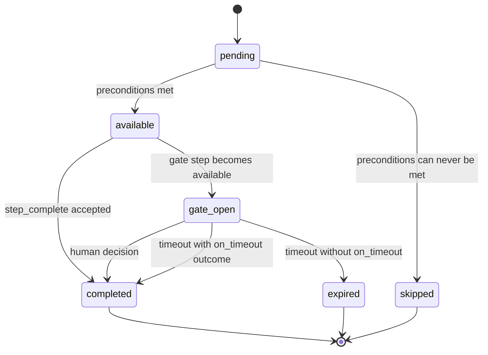
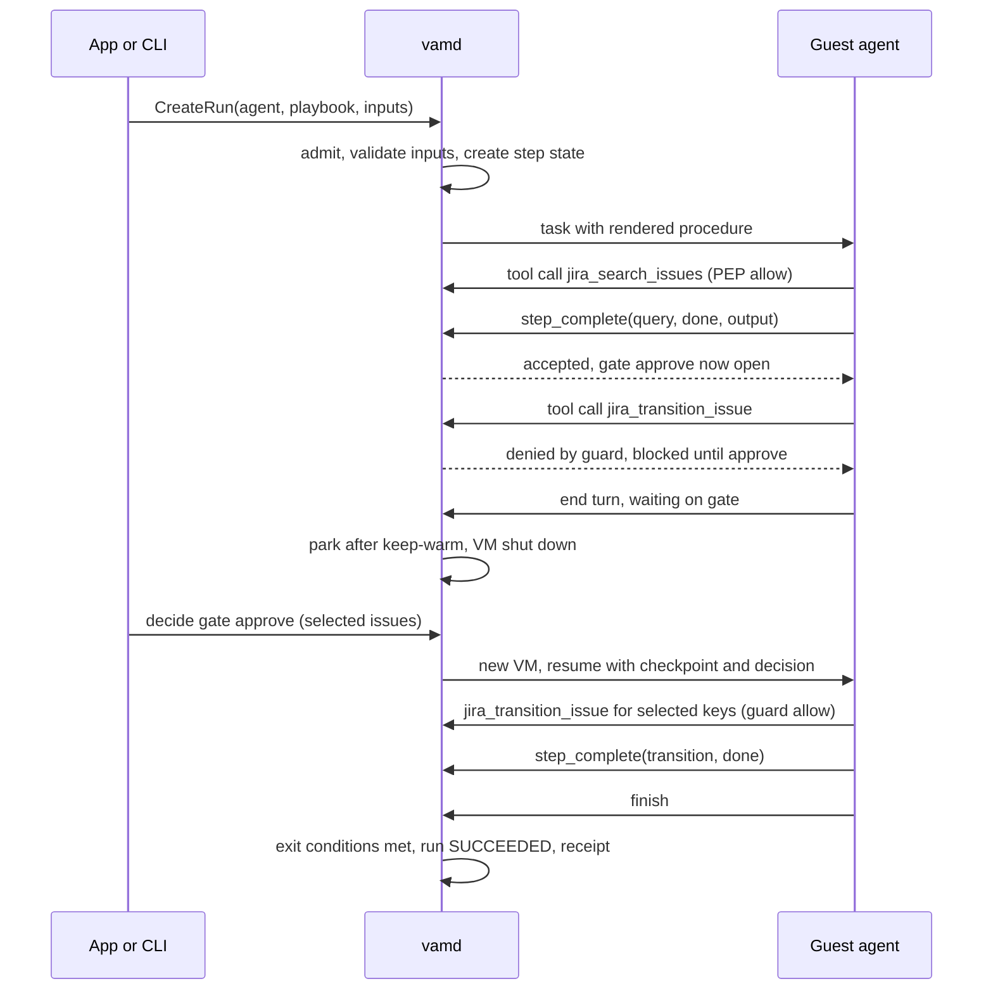

# Playbooks: host-tracked procedures with guards and gates

**Status:** Proposed (rewrite of the 2026-10-09 host-enforced DAG draft)
**Date:** 2026-10-09
**Owner:** maintainer
**Repos:** `squrell-inc/VAM` and the app repo (app issues only)

## Decision record

**Context.** VAM stores playbooks as catalog artifacts (`PlaybookSpec` in
`proto/vam/v1/workflow.proto`, CRUD and release in
`crates/vam-orchestrator/src/catalog.rs`) but never executes them. At
admission the host only pins `playbook_ref`
(`catalog_resolve.rs::record_resolved_refs`). No code in `vam-runtime` reads a
playbook, and `driver.rs` sends the user prompt as a single `PromptAction`. A
playbook run is a plain prompt run today.

The previous draft of this document proposed a host-walked DAG: the host owns
a cursor and sends one guest task per node. Review found two problems:

1. **Path enforcement is not effect enforcement.** An `agentic` node keeps the
   full tool set, so the agent in node A can call the mutating tool meant for
   node E. What users need guaranteed is the order of side effects and human
   decisions, not the order of reasoning.
2. **Keeping the VM alive at human gates rules out real SOPs.** Approvals in
   purchase, change and close procedures take days. Paying for an idle VM per
   minute, with a 1 hour expiry, is not viable.

**Decision.** A playbook is a **job contract plus host-enforced guarantees**:

- **Steps** the agent completes by declaring an allowed outcome. The host owns
  the run's step state and rejects illegal transitions.
- **Guards**: deny-only rules evaluated at the PEP on every tool call, keyed on
  the run's step state ("no external mutation before gate `approve` says
  `approved`").
- **Gates**: human decisions created by the host, with a structured response
  (pick a branch, select a subset, amend values).
- **Exit conditions**: a run cannot succeed until required steps and gates are
  complete and outputs match `output_schema`.

The default execution mode is **guided**: one agent session sees the whole
procedure and may work in any order the preconditions allow. Waits for humans
**park the run, not the VM**: the VM shuts down and a fresh one resumes the run
when the decision arrives, hours or days later.

> Effects are strict. Reasoning is free. Waiting is free.

**Amends.** `.cursor/workstreams/developer-experience.md` decision 16
(dual-layer procedure). Kept: prose on every step, the `bound` / `assisted` /
`agentic` binding modes, "enforcement lives on tools", no per-step
`advisory` / `enforced` flag, no scheduler. Changed: the host now tracks step
state and rejects illegal transitions. The agent may still reorder, but may not
skip a required step or complete a step whose preconditions are unmet.

## Audience and positioning

Open source, developer-first. The first users are developers who build
automations for ops and audit teams. Lead with the outcome: *the agent ran in a
microVM and came back with a receipt* — the steps it took, the evidence the
host observed, and the approvals given. Guarantees are presented as that
receipt, not as compliance language. Isolation claims in docs and marketing
must be backed by a test or a doc page.

## What we are building

1. **Playbook spec v2.** Steps with outcomes and preconditions, gate steps,
   guards, per-step output schemas. Validated at publish.
2. **Host-owned run state.** Per run, per step: state, outcome, output,
   summary, evidence. Persisted in the workflow store and surfaced through the
   existing `RunStatus.step_statuses`.
3. **Guided execution.** The procedure, with inputs rendered, is delivered to
   the agent as a run-scoped instruction layer. The agent advances with a
   built-in `step_complete` tool. The host validates each call.
4. **Park and resume.** Any human wait (gate or tool-level HITL) checkpoints the
   conversation on the host, shuts the VM down after a short keep-warm window,
   and boots a new VM on decision.
5. **Guards, gates, evidence, exit conditions.** The enforcement layer.
6. **Run receipt.** CLI and app view of the path taken, outcomes, evidence and
   approvals.
7. **Developer tooling.** `vam playbook init / explain / test`, examples, and a
   repeated-run adherence harness.

## Why

- Prior art converges on split control: deterministic code owns the process,
  the model owns reasoning inside bounded steps (LangGraph, Rasa CALM
  FlowPolicy, Microsoft Agent Framework, Mastra, Google ADK).
- Runtime guards at the tool boundary have the strongest evidence for policy
  adherence (AgentSpec, arXiv 2503.18666; IBM policy-to-guard compilation,
  EMNLP Industry 2025). Prompt-only adherence is inconsistent across repeated
  runs (tau-bench, arXiv 2406.12045).
- Long human waits everywhere else use checkpoint + resume event, not a live
  process (Temporal signals, LangGraph interrupts, Inngest `waitForEvent`,
  Step Functions task tokens).
- The closest products are adaptive, not lockstep: Parlant journeys allow
  jumps within a state graph; Decagon AOPs pair natural-language procedures
  with code-backed guardrails.
- VAM already has the enforcement point: the PEP sees every tool call with
  side-effect class, args digest, iteration and spend
  (`crates/vam-orchestrator/src/security.rs`, `EvaluationContext`). It also
  has a guest conversation checkpoint for HITL
  (`crates/vam-runtime/src/hitl_checkpoint.rs`).

## What we are not building

- **No prose-only playbooks.** Every playbook is host-tracked. Procedure prose
  without tracking belongs in a skill's `SKILLS.md`; docs say so.
- No catalog pinning or approve-before-update. Separate design.
- No expression language (CEL) in conditions. Preconditions reference step
  outcomes; templates are plain path substitution.
- No loops or back-edges (check, fix, re-check). A step's outcome is final.
- No parallel guest execution. One agent session per run.
- No retry backoff schedules, quorum joins, compensation, or
  `fallback_step_id`. Rejected at publish.
- No driven mode (one guest task per step) until Phase 2 data says guided mode
  is not enough. See Phase 4.
- No visual editor. Authoring is JSON/YAML.
- No role-based approver routing beyond today's HITL rules.
- No triggers (schedules, events). Named as the next gap, not built here.
- No change to the `max_iterations` hard cap.

## Decision summary (locked)

| Topic | Decision |
| --- | --- |
| What a playbook is | Job contract (inputs, outputs, requirements) plus host-enforced steps, guards, gates, exit conditions. |
| Prose-only playbooks | Removed. Prose guidance is a skill. |
| Execution mode | Guided: one agent session, full procedure visible, host validates every transition. |
| Ordering | Preconditions (`after`, `after_any`) on step outcomes. Agent may do available steps in any order. |
| Outcomes | Declared per step. Final once recorded. Every task step implicitly allows `failed`. |
| Enforcement of effects | Guards: deny-only, evaluated in the PEP alongside Cedar. Playbooks never grant permissions. |
| Human decisions | Gate steps with a structured response schema. Branch choice is a special case. |
| Waiting | Park the run, not the VM. Keep-warm window (default 5 min), then shut down. Resume on a fresh VM. |
| Workspace while parked | Reserved by the parked run. Other runs get a clear error with a cancel path. |
| Gate timeout | Per gate, default 72 h, max 30 days. Optional `on_timeout` outcome; otherwise run ends `EXPIRED`. |
| Run duration | `max_duration` counts active time, not parked time. |
| Bound steps | Guided: built-in `run_step(step_id)` executes the bound call through the PEP. No argument synthesis. |
| Templates | `{{inputs.x}}` and `{{steps.<id>.output.<path>}}`, rendered by the host. Templated binding args make a step `assisted`. |
| Pinning | Out of scope (separate design). Runs keep using `resolved_refs`. |

## Target model

### Roles

**vamd (host): the authority**
- Admits the run: loads the pinned playbook, validates `inputs` against
  `input_schema`, creates run step state, renders the procedure.
- Validates every `step_complete`: step exists and is available, outcome is
  declared, output matches the step's `output_schema`, evidence (if required)
  was observed.
- Opens gates when they become available; parks and resumes runs.
- Evaluates guards on every tool call; exposes run step state to Cedar.
- Checks exit conditions when the agent tries to finish.
- Produces the run receipt.

**Guest agent (vam-runtime): labor**
- Receives the procedure as a run-scoped instruction layer.
- Works through available steps in any order, calls `step_complete`, and
  `run_step` for bound steps.
- Treats tool errors from the host (illegal transition, guard deny) as normal
  observations and adapts.
- Writes a conversation checkpoint whenever the run parks.

**The VAM app and CLI: viewers and deciders**
- Show step progress and the run receipt.
- Render gate forms from the gate's response schema.
- `vam approve` decides gates and tool approvals from the CLI.

### Step state machine

A step is `skipped` when its preconditions reference outcomes that can no
longer happen (the referenced step completed with a different outcome or was
itself skipped). Because the graph is acyclic and outcomes are final, the host
computes this exactly.

API mapping: these states map onto `StepExecutionStatus.StepState`, adding one
value, `AVAILABLE`.

### Step kinds

| Kind | Who acts | Ends with |
| --- | --- | --- |
| `task` | Agent, optionally with a bound/assisted tool | One declared outcome via `step_complete`, or the bound call's result via `run_step` |
| `gate` | Human | Decision validated against the gate's response schema |

### Preconditions

- `after: ["B", "C:approved"]`: all must hold. A bare step id means "completed
  with any outcome"; `id:outcome` means that outcome.
- `after_any: ["C", "D"]`: at least one must hold. Used to merge exclusive
  branches ("E after C or D").
- Both may be set; both must hold. Steps with neither are available at start.

### Outcomes

- Each step lists `outcomes[]`: `{label, description, terminal?}`.
- `terminal: succeeded | failed` ends the run immediately when that outcome is
  recorded; remaining steps become `skipped`. Example: gate outcome `rejected`
  with `terminal: succeeded` is a clean stop.
- A task step with no declared outcomes has the single outcome `done`.
- Every task step implicitly allows `failed` (the agent cannot do the step).
  Unless the author declares `failed` and something depends on it, `failed` is
  terminal `failed`. This separates honest failure from errors.

### Gates

- Fields: `question` (template), `response_schema` (JSON Schema) or `options`
  (branch shorthand: each option is an outcome), optional `choices_from`
  (`steps.<id>.output.<path>`, fills the schema's enum at open time, e.g.
  "select which issues to move"), `timeout`, `on_timeout`, `keep_warm`.
- Form gates have outcomes `submitted` and `rejected`; the validated response
  becomes the step output, available to templates and guards.
- The gate view shows host-verified evidence next to agent-written summaries.
  Agent text is untrusted and rendered as such, so a misleading summary cannot
  pass as fact to the approver.

### Guards

- Shape: a target (`tools: [...]` and/or `side_effects: [MUTABLE_EXTERNAL,
  ...]` from `SideEffectClass`) plus `allowed_when` (same syntax as `after`).
- Optional `args_within`: tool argument path must be a member of a gate output
  path. Example: `jira_transition_issue.issue_key` within
  `steps.approve.output.selected[*].key`. The approval limits what can be
  done, not just whether.
- Deny-only. Evaluated in the PEP after Cedar; either can deny, neither can be
  overridden by the other. Denials return a reason the agent can act on
  ("blocked until step `approve` is `approved`").
- Run step state is also exposed in the Cedar context (`context.playbook`) so
  org policies can reference it.

### Evidence and bound steps

- A step may require evidence: `evidence: {tool: "x", result: "success"}`.
  The host accepts a non-`failed` outcome only if the PEP recorded a matching
  successful call in this run while the step was available.
- Bound steps (literal args, digest computable at publish) run through
  `run_step(step_id)`: the host executes the binding through the normal PEP
  path and records the outcome from the result. No argument synthesis.
- Bound args containing `{{...}}` are templated: the step is `assisted`, the
  digest is computed at call time.

### Exit conditions

When the agent tries to finish, the host checks: every reachable required step
is `completed`, no gate is open, run output matches `output_schema`. If not,
the host returns the missing items to the agent as an observation, up to the
iteration cap. A run that ends incomplete is `FAILED` with the missing items in
its error.

## Sequences

### Guided run with a gate and a guard

### Park and resume

1. A wait starts: a gate opens and the agent has no available task step left,
   or the PEP suspends a tool call for HITL.
2. The guest writes its conversation checkpoint and uploads it to the host
   (stored per run and lifecycle generation, digest-verified).
3. The run is `PAUSED`. The host emits `vam.v1.hitl.paused` and calls
   `on_paused` hooks.
4. After `keep_warm` (default 5 min) with no decision, the host shuts the guest
   down gracefully (Drive9 flush), terminates the session and keeps a workspace
   reservation for the run.
5. On decision: if the VM is still warm, resume in place. Otherwise boot a new
   session on the workspace, issue a lease with a higher lifecycle generation,
   and send a resume task carrying the checkpoint and the decision.
6. On timeout: follow `on_timeout` if declared (resume with that outcome);
   otherwise mark the run `EXPIRED`, release the reservation, and terminate any
   warm VM.

**Things that must survive a VM change**

| Item | Today | Change |
| --- | --- | --- |
| Secret placeholders in history | Random per session (`vam-network/src/secrets.rs::generate_placeholder`) | Stable per run (keyed hash of host secret, run id, binding) |
| Spend, tokens, iteration counters | Per session in the PEP (`security.rs`, `iteration_counter`, `budget`) | Per run, persisted |
| Conversation checkpoint | Single path in the workspace (`.vam/agent/hitl-continuation.json`) | Stored on the host per run; workspace copy not authoritative |
| Approval grants | Host DB (`store_has_grant`) | Unchanged |
| Workspace lock | Released when the session ends | Run reservation while parked |
| Expiry | Hardcoded `+ 3600` in `security.rs`; sweeper updates DB only | Per gate / configurable; sweeper terminates warm VMs and releases reservations |

A parked run has no VM, so `vamd` restart reconciliation has nothing to adopt
for it. It is rows in the store.

## Data model (conceptual)

### Playbook spec v2

| Today (`PlaybookStep`) | v2 |
| --- | --- |
| `id`, `description`, `instruction`, `binding`, `mode` | Keep. `instruction` required for `task`. |
| `depends_on` | Replaced by `after` (bare ids). Migrated at publish. |
| `retry_policy`, `fallback_step_id`, `join_policy`, `required_successes`, `evaluation_policy` | Rejected at publish if set. |
| — | `kind`: `task` / `gate` |
| — | `outcomes[]`: label, description, optional `terminal` |
| — | `after[]`, `after_any[]` |
| — | `optional` (default false) |
| — | `output_schema` (per step) |
| — | `evidence` |
| — | Gate fields: `question`, `response_schema` or `options`, `choices_from`, `timeout`, `on_timeout`, `keep_warm` |

`PlaybookSpec` keeps `input_schema`, `output_schema`, `requires`, metadata,
and gains `guards[]`.

Publish validation:
- Step ids unique; every precondition references an existing step and a
  declared outcome; no cycles; every step reachable from the start set.
- At least one path reaches completion (all required reachable steps can
  complete).
- Gates: no binding; `options` has ≥ 2 entries or `response_schema` is set;
  `choices_from` references a step that precedes the gate; timeout ≤ 30 days.
- Guards reference existing steps/outcomes and known side-effect classes.
- Templates reference only `inputs` and steps that precede the use.
- Lint (warning, not error): a playbook with no gates, guards, bindings or
  evidence enforces only step tracking.

Migration: linear playbooks become `task` steps with `after` from
`depends_on`. The jira example and baseline fixtures are rewritten by hand.

### Run state (workflow store)

- `run_playbook`: run id, playbook urn/version/digest, state.
- `run_playbook_steps`: run id, step id, state, outcome, output JSON, agent
  summary, evidence refs, timestamps, transition revision.
- `run_checkpoints`: run id, lifecycle generation, digest, blob ref.
- `run_reservations`: workspace id, run id, created, expires.

### HITL (`proto/vam/v1/hitl.proto`)

- Approval kind: `tool_call` (today) or `gate`. `step_id` is the gate step.
- Decision `SUBMITTED` with a `response` struct validated against the gate's
  schema; branch gates use it with the chosen option.
- `expires_at` from the gate timeout; tool-level HITL timeout configurable.

## Phases

Each phase lists proposed issues. IDs (`PB-x.y`) are local; each issue must be independently reviewable.

| Phase | Goal | Depends on |
| --- | --- | --- |
| 0 | Playbooks run and produce a receipt | — |
| 1 | Park and resume for all human waits | — (parallel with 0) |
| 2 | Guided enforcement: gates, guards, evidence, exit conditions | 0, 1 |
| 3 | Developer tooling and examples | 0 (grows with 2) |
| 4 | Driven mode (conditional) | 2 + adherence data |

### Phase 0 — Playbooks run and produce a receipt

**Exit:** the rewritten jira example runs end to end; `RunStatus.step_statuses`
shows each step's state and outcome; illegal `step_complete` calls are
rejected; a run with incomplete required steps ends `FAILED` with the missing
steps listed.

- **PB-0.1 Playbook spec v2 (proto + validation).** `kind`, `outcomes`,
  `after`, `after_any`, `optional`, per-step `output_schema`, `evidence` and
  gate fields (accepted by the schema; executed in Phase 2), `guards` on
  `PlaybookSpec`. Publish validation and rejection of retired fields.
  Migration of `depends_on`. Files: `proto/vam/v1/workflow.proto`,
  `crates/vam-spec/src/validation.rs`, `crates/vam-spec/src/playbook.rs`,
  baseline fixtures. Tests: `cargo test -p vam-spec`.
- **PB-0.2 Run step state in the workflow store.** Tables, state transitions
  (pending, available, completed, skipped), skip propagation, `step_statuses`
  in `RunStatus`. Files: `crates/vam-orchestrator/src/workflow.rs`,
  `build_run_status` in `api/mod.rs`. Blocked by PB-0.1.
- **PB-0.3 Admission and procedure delivery.** On `CreateRun` with a
  playbook: load pinned spec, validate inputs, init step state, render
  templates on the host, deliver as a run-scoped instruction layer. Runtime
  renders it into the prompt (new `SYSTEM.md` placeholder, template version
  bump). Files: `api/mod.rs::create_run`, `run_context.rs`,
  `crates/vam-runtime/src/instruction.rs`, `templates/SYSTEM.md`. Blocked by
  PB-0.2.
- **PB-0.4 `step_complete` built-in.** Host-side built-in tool on the existing
  host tool path (through the PEP). Validates availability, outcome, output
  schema; returns the updated state (available steps, open gates). Runtime
  advertises it only on playbook runs. Blocked by PB-0.2.
- **PB-0.5 Run limits for playbook runs.** Guest task timeout from the run's
  `max_duration` instead of the hardcoded 120 s; playbook-level
  `max_iterations` within the existing hard cap. Files: `api/mod.rs`
  (`dispatch_run_prompt`, resume paths), `driver.rs`. No dependency.
- **PB-0.6 Run finish check (minimal).** On task end, compute completeness;
  set `SUCCEEDED` or `FAILED` with missing steps. Blocked by PB-0.4.
- **PB-0.7 Example and docs.** Rewrite `examples/jira-assistant/playbook.json`
  to v2; rewrite `docs/src/content/docs/authoring/playbook-spec.md`; note that
  prose-only procedures belong in skills. Blocked by PB-0.1.
- **PB-0.8 CLI receipt.** `vam run --follow` output shows step progress; a
  receipt command (candidate: extend the existing `vam evidence`) prints
  steps, outcomes, summaries and evidence as markdown. Blocked by PB-0.2.

### Phase 1 — Park and resume

Built first for today's tool-level HITL, so it ships value before gates exist.

**Exit:** a tool approval decided 24 h later (simulated clock) resumes on a new
VM and completes; spend and iteration counts carry over; secret placeholders
in history still substitute; a `vamd` restart while parked loses nothing;
expiry releases the workspace and any warm VM.

- **PB-1.1 Expiry terminates the session.** `expire_stale_approvals` (driven
  from `bin/vamd.rs`) terminates the run's session and releases the workspace
  lock. Ships alone. Files: `workflow.rs`, `bin/vamd.rs`.
- **PB-1.2 Run-level metering.** Move iteration, spend and token counters
  from the per-session PEP to per-run persisted state. Files: `security.rs`,
  `workflow.rs`.
- **PB-1.3 Run-stable secret placeholders.** Files:
  `crates/vam-network/src/secrets.rs` and call sites. Security review
  required.
- **PB-1.4 Host-stored checkpoint.** Guest uploads the continuation on
  suspend; host stores per run and generation; resume sends it back. Files:
  `crates/vam-runtime/src/hitl_checkpoint.rs`, `agent.rs`, orchestrator
  resume path, vsock RPC.
- **PB-1.5 Park.** Keep-warm timer, graceful shutdown, session terminate,
  workspace reservation; `CreateRun` on a reserved workspace returns a typed
  error naming the run and the cancel command. Blocked by PB-1.2, PB-1.3,
  PB-1.4.
- **PB-1.6 Resume on a fresh VM.** Boot session, higher lifecycle generation,
  resume task with checkpoint and decision; failure to boot fails the run
  cleanly. Blocked by PB-1.5.
- **PB-1.7 Durations.** `max_duration` counts active time; tool-level HITL
  timeout configurable (operator default). Blocked by PB-1.5.
- **PB-1.8 Notify and decide.** `on_paused` HSP hook phase; `vam approve`
  lists parked runs and decides. Files: `proto/vam/v1/hosted_services.proto`,
  `hsp_hooks.rs`, `crates/vam-cli/src/cmd/approve.rs`. Blocked by PB-1.5.
- **PB-1.9 Restart and reconcile tests.** Parked runs survive `vamd` restart;
  reservations are not dropped by `reconcile.rs`. Blocked by PB-1.6.

### Phase 2 — Guided enforcement

**Exit:** in adversarial tests (agent prompted to skip the approval) no guarded
tool executes before its gate; a selection gate limits later tool arguments;
evidence-required steps cannot be completed without the observed call; runs
cannot succeed with missing steps.

- **PB-2.1 Gate execution.** Open gates when available, approval kind `gate`,
  `SUBMITTED` decision with schema validation, `options` and `choices_from`,
  timeout and `on_timeout`, park integration. Files: `hitl.proto`, `hitl.rs`,
  `workflow.rs`, `api/mod.rs`. Blocked by Phase 0, PB-1.6.
- **PB-2.2 Guards in the PEP.** Deny-only evaluation after Cedar; actionable
  denial messages; `context.playbook` in Cedar context. Files: `security.rs`.
  Blocked by PB-0.2.
- **PB-2.3 Approval-scoped arguments.** `args_within` guards. Blocked by
  PB-2.1, PB-2.2.
- **PB-2.4 Evidence and `run_step`.** Evidence checks on `step_complete`;
  `run_step` built-in for bound steps with publish-time digest. Blocked by
  PB-0.4.
- **PB-2.5 Exit conditions with feedback.** Finish attempts checked by the
  host; missing items returned to the agent; final output validated against
  `output_schema`. Blocked by PB-0.6.
- **PB-2.6 App: progress and gate forms** (the app repo). Step list,
  receipt view, gate form rendered from `response_schema`, evidence beside
  agent summaries. Blocked by PB-2.1.

### Phase 3 — Developer tooling and examples

**Exit:** a developer can scaffold, explain, test and run a playbook from the
CLI, and see repeated-run adherence for it.

- **PB-3.1 `vam playbook init` and `explain`.** Scaffold a v2 playbook;
  explain prints steps, modes, guards, gates, and the bound/assisted ratio.
- **PB-3.2 `vam playbook test`.** Run against mocked tools with assertions on
  path and outcomes; `--repeat k` reports pass^k.
- **PB-3.3 Examples.** At least three: sprint cleanup (selection gate), PR
  review with approval, invoice approval with branch gate. Docs tutorial.
- **PB-3.4 Publish lint.** Warn when a playbook enforces nothing beyond step
  tracking.

### Phase 4 — Driven mode (conditional)

Decide after Phase 2 using adherence data. Scope if approved: one guest task
per step, host-executed bound steps with no LLM turn, per-step agent or model,
per-step tool scoping. Not split into issues yet.

## Open questions

1. **Gate approvers:** any workspace member who can see the run (as tool HITL
   today), or optional `required_roles` per gate? Draft: today's rule.
2. **Reservation UX:** should a member be able to force-cancel another
   member's parked run on a shared workspace?
3. **Checkpoint retention:** delete on run end, or keep for replay with the
   trajectory?
4. **Iteration cap:** long playbooks may need more than 100 iterations across
   all steps. Revisit per-step budgets if Phase 3 tests hit the cap.
5. **Driven mode trigger:** what adherence number from Phase 3 tests would
   justify Phase 4?

## PR base

TBD. Proposed: `feat/playbooks` cut from `feat/improving-the-vam`.

## Issue index

Branch: `feat/playbooks`.

### Phase 0

| ID | Title | Blocked by |
| --- | --- | --- |
| PB-0.1 | Playbook spec v2 (proto + validation) | — |
| PB-0.2 | Run step state in the workflow store | PB-0.1 |
| PB-0.3 | Admission and procedure delivery | PB-0.2 |
| PB-0.4 | `step_complete` built-in | PB-0.2 |
| PB-0.5 | Run limits for playbook runs | — |
| PB-0.6 | Run finish check (minimal) | PB-0.4 |
| PB-0.7 | Example and docs | PB-0.1 |
| PB-0.8 | CLI receipt | PB-0.2 |

### Phase 1

| ID | Title | Blocked by |
| --- | --- | --- |
| PB-1.1 | Expiry terminates the session | — |
| PB-1.2 | Run-level metering | — |
| PB-1.3 | Run-stable secret placeholders | — |
| PB-1.4 | Host-stored checkpoint | — |
| PB-1.5 | Park | PB-1.2, PB-1.3, PB-1.4 |
| PB-1.6 | Resume on a fresh VM | PB-1.5 |
| PB-1.7 | Durations | PB-1.5 |
| PB-1.8 | Notify and decide | PB-1.5 |
| PB-1.9 | Restart and reconcile tests | PB-1.6 |

Phases 2–4: not created yet.

## Implementer constraints

- The guest never moves step state. Only the host commits outcomes.
- Guards are deny-only. Playbooks never grant a permission Cedar denies.
- The PEP still evaluates Cedar on every tool call, including `run_step`.
- Agent-written summaries and outputs are untrusted; render them as such.
- Keep HITL checkpoint compatibility for tool-level suspends.
- Keep `max_iterations` as the per-run agent loop cap; do not raise the hard
  cap.
- Never expose host paths or real secrets to the guest; stable placeholders
  are still placeholders.
- A run's `resolved_refs` are immutable once admitted.
- Add focused tests per issue; run `cargo test -p vam-spec`,
  `cargo test -p vam-orchestrator`, `cargo test -p vam-runtime` as relevant,
  plus `cargo check --workspace` and `cargo fmt --all --check`.
- If an issue changes a public contract, update the Starlight docs and
  `docs/astro.config.mjs` when pages move.
