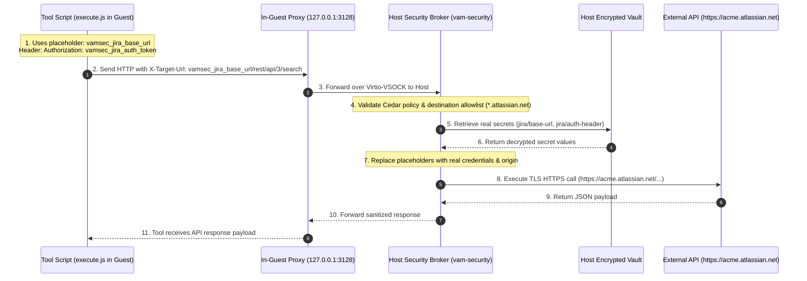

:::caution[To be deprecated in E8 Phase 2]
The `X-Target-Url` flow on this page is the legacy port-54 path. E8 Phase 2 replaces it: the guest dials the HTTP forward proxy on vsock port 55 with a normal `HTTPS_PROXY`, and the host terminates TLS with a per-session CA. Do not build new guests on `X-Target-Url`.
:::

When AI agents execute tool scripts inside a microVM, allowing them direct outbound internet access or injecting raw credentials into the VM filesystem creates significant security vulnerabilities:
- **Credential Exfiltration**: A hallucinating or malicious agent could leak API keys via DNS tunneling or HTTP headers.
- **SSRF & Uncontrolled Pivoting**: An agent could probe private internal services on the local network.
- **Supply-Chain Tampering**: Script dependencies could transmit credentials to attacker-controlled endpoints.

VAM solves this with a **Zero-Trust Secret Injection Proxy**.

---

## Architecture Overview

In VAM, the guest microVM has no direct Internet connectivity. All outbound API interactions use **scheme-less placeholder tokens** routed through an in-guest proxy to the host-side security broker:



---

## Key Design Principles

### 1. Scheme-less Placeholders (No `https://`)

Guest scripts never write `https://` when defining API targets. Instead, they use logical placeholders:

```javascript
// Target URL placeholder
const JIRA_BASE_PLACEHOLDER = "vamsec_jira_base_url";

// Auth token placeholder
const JIRA_AUTH_PLACEHOLDER = "vamsec_jira_auth_token";
```

:::important[Why Scheme-less?]
Omitting `https://` prevents HTTP clients (like Bun, Node `fetch`, or Axios) from treating placeholders as real hostnames, preventing DNS lookup failures or accidental direct outbound socket attempts.
:::

---

### 2. The `X-Target-Url` Header

The tool executor connects to the in-guest proxy endpoint (`http://127.0.0.1:3128` or `/tmp/vam-egress.sock`) and sets the `X-Target-Url` header:

```javascript
const headers = {
  "X-Target-Url": "vamsec_jira_base_url/rest/api/3/issue/VAM-123",
  "Authorization": JIRA_AUTH_PLACEHOLDER,
  "Content-Type": "application/json"
};
```

---

### 3. Host-Side Validation & Secret Substitution

When the request arrives on the host orchestrator:

1. **Cedar Policy Check**: The Policy Decision Point (PDP) verifies whether the running agent has the right to execute this tool and outbound action.
2. **Domain Validation**: The host checks the resolved destination against the `--allowed-destination` rule (e.g. `*.atlassian.net`). Requests to unexpected domains are rejected with `403 Forbidden`.
3. **Vault Lookup**: The host decrypts the actual credentials (`jira/base-url` and `jira/auth-header`) from the encrypted vault.
4. **Upstream Request**: The host constructs a real HTTPS request, establishes TLS, and performs the external call.
5. **Response Scrubbing**: The response is returned to the guest microVM without leaking any host configuration.

---

## Configuring Egress Secrets with `vam` CLI

To configure secrets for the egress broker:

```bash
# Set Jira base URL (tenant origin)
vam secrets set jira/base-url \
  --kind egress \
  --value "https://acme.atlassian.net" \
  --allowed-destination "*.atlassian.net"

# Set Jira authorization token from environment variable
vam secrets set jira/auth-header \
  --kind egress \
  --from-env JIRA_AUTH_TOKEN \
  --allowed-destination "*.atlassian.net"
```

Verify secrets are registered in the vault:

```bash
vam secrets list
```

Output:
```text
BINDING ID           KIND       DESTINATION            UPDATED AT
jira/base-url        egress     *.atlassian.net        2026-08-22 05:00:00 UTC
jira/auth-header     egress     *.atlassian.net        2026-08-22 05:00:00 UTC
```

---

## Next Steps

- Walk through the full implementation in [Jira Assistant Walkthrough](/integrations/jira-assistant-walkthrough/).
- Learn how to authorize tools and HITL gates in [Cedar Policies & HITL](/authoring/agent-spec/).
