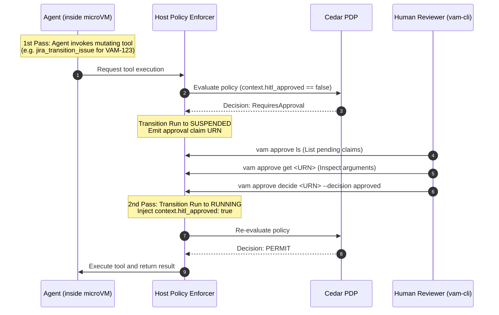

VAM incorporates a native **Human-in-the-Loop (HITL)** governance engine that pauses execution when an autonomous agent attempts high-risk or mutating operations (e.g. database updates, Jira status transitions, deleting resources, or moving funds).

---

## The Two-Pass Execution Model

To guarantee safety without killing or restarting the agent's reasoning session, VAM uses a deterministic **Two-Pass Execution Model**:



---

## Step-by-Step CLI Walkthrough

### 1. Agent Initiates a Mutating Action

When an agent executes `run.json` and reaches a tool requiring authorization (e.g. transitioning issue `VAM-123` to *In Progress*), the terminal following the run displays:

```text
[vam] Agent invoked tool 'jira_transition_issue'.
[vam] Action requires human authorization (Cedar rule: hitl_approved == true).
[vam] Run SUSPENDED. Waiting for human approval decision...
[vam] Approval URN: urn:vam:approval:0198a2e1-4821-7291-a1b2-c98129e01234
```

---

### 2. List Parked Runs (`vam approve ls`)

In a second terminal window, list parked runs waiting on tool-level HITL **owned by the calling user**. A run is listed while it is `PAUSED`: during the keep-warm window the VM is still up, and after that window the VM is shut down and the workspace stays reserved. Another user's pending HITL (and its `requested_args`) is not listed; a cross-user get is 404. Only the selected approver (default: the run owner) may decide. There is no reviewer or manager role yet.

```bash
vam approve ls
```

Output:
```text
parked  run=urn:vam:run:local.vam.dev/acme/run-1  tool=jira_transition_issue  approval=urn:vam:hitl:local.vam.dev/acme/approval-1
```

`vam approve decide` on that approval resumes a warm VM in place. After keep-warm park, the same decision boots a new VM on the reserved workspace and continues from the host-stored checkpoint. `--json` prints the `ListApprovalsResponse` document instead of these lines.

---

### 3. Inspect the Proposed Arguments (`vam approve get`)

Inspect the exact tool parameters the agent wants to execute, along with risk metadata:

```bash
vam approve get urn:vam:approval:0198a2e1-4821-7291-a1b2-c98129e01234
```

Output:
```json
{
  "approvalId": "urn:vam:approval:0198a2e1-4821-7291-a1b2-c98129e01234",
  "runId": "urn:vam:run:local.vam.dev/vam/jira-run-001",
  "agentUrn": "urn:vam:agent:local.vam.dev/vam/jira-assistant",
  "toolName": "jira_transition_issue",
  "arguments": {
    "issue_key": "VAM-123",
    "transition_id": "In Progress"
  },
  "riskLevel": "MUTABLE_EXTERNAL",
  "status": "PENDING",
  "createdAt": "2026-08-22T05:00:00Z"
}
```

---

### 4. Submit an Approval Decision (`vam approve decide`)

The human reviewer can resolve the request using one of three decisions:

#### Option A: Approve (`--decision approved`)
Resumes execution with the original proposed arguments:

```bash
vam approve decide urn:vam:approval:0198a2e1-4821-7291-a1b2-c98129e01234 \
  --decision approved
```

#### Option B: Reject (`--decision rejected`)
Rejects the action. The host injects a human rejection message into the agent's ReAct context so it can handle the refusal gracefully:

```bash
vam approve decide urn:vam:approval:0198a2e1-4821-7291-a1b2-c98129e01234 \
  --decision rejected
```

#### Option C: Amend (`--decision amended`)
Modifies the arguments before execution (e.g. changing the target status or issue key):

```bash
vam approve decide urn:vam:approval:0198a2e1-4821-7291-a1b2-c98129e01234 \
  --decision amended \
  --amended-args '{"issue_key": "VAM-123", "transition_id": "Ready for Review"}'
```

---

## What Happens Upon Decision

1. **On `approved`**: The host updates the execution context with `context.hitl_approved = true`, resumes the microVM, and allows the tool script to execute.
2. **On `rejected`**: The host returns an error result (`"Tool execution was rejected by human operator"`) to the agent, allowing the LLM to choose an alternative strategy or report back to the user.
3. **On `amended`**: The host overrides the arguments on standard input and executes the tool with the human-corrected parameters.

---

## Next Steps

- Learn how to manage credentials in [Secrets Vault Management](/security/secret-management/).
- Review [Cedar Policy Authoring](/security/cedar-and-hitl/).
