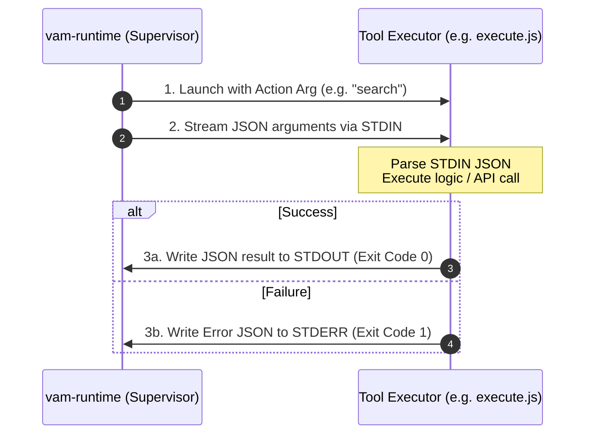

In VAM, tools defined by skills do not run on the host system. Instead, they execute inside an isolated **Firecracker microVM** under strict security and privilege constraints.

This guide explains the microVM execution environment and the standard protocol for building tool executor scripts (`execute.js`, `execute.py`, or shell runners).

---

## The MicroVM Execution Sandbox

When an agent invokes a tool, the in-guest supervisor (`vam-runtime`) spawns a child subprocess inside the microVM with the following security guarantees:

```
┌─────────────────────────────────────────────────────────────────────────────┐
│ FIRECRACKER MICROVM (GUEST)                                                │
│                                                                             │
│  [vam-runtime Guest Supervisor (PID 1)]                                     │
│      │                                                                      │
│      │ fork & drop privileges (uid=1000, gid=100)                           │
│      ▼                                                                      │
│  [Tool Executor Subprocess: bun execute.js search]                          │
│      ├── STDIN  ◀── JSON arguments from LLM (e.g. {"jql": "..."})           │
│      ├── STDOUT ──▶ JSON output result returned to LLM                      │
│      └── STDERR ──▶ Error trace / diagnostics                               │
│                                                                             │
│  FILESYSTEM PERMISSIONS:                                                    │
│  ├── /mnt/drive9/skills/<skill-id>/   ──▶ READ-ONLY (Skill Code & Manifest) │
│  ├── /mnt/drive9/workspace/           ──▶ READ-WRITE (User Workspace Files) │
│  └── /tmp/                            ──▶ READ-WRITE (Ephemeral Scratch)    │
└─────────────────────────────────────────────────────────────────────────────┘
```

### Security Properties
1. **Dropped Privileges**: Subprocesses run as an unprivileged user (`uid=1000`, `gid=100`). Root operations (`sudo`, modifying system mounts) are strictly prevented.
2. **Immutable Skill Code**: The skill directory (`/mnt/drive9/skills/<skill-id>/`) is mounted **read-only**. An agent cannot tamper with or rewrite its own tool binaries.
3. **Workspace Isolation**: Tools can read and write files under `/mnt/drive9/workspace/`. All changes are tracked and persisted to the Drive9 volume upon run completion.
4. **No Direct External Network Access**: Outbound internet traffic is blocked at the network layer. External API calls must pass through the in-guest security proxy (`127.0.0.1:3128`).

---

## The Standard Tool Protocol

All tool executor scripts follow a simple, deterministic **JSON-in / JSON-out** convention over standard I/O streams:



### 1. Action Routing (`process.argv[2]`)
The first command-line argument passed to your script indicates the specific tool action being invoked (matching `localExec.defaultArgs` in `manifest.json`). The runtime resolves `./execute.js` against the skill directory before it launches the interpreter:

```bash
bun ./execute.js search
```

### 2. Reading Input (`stdin`)
Arguments provided by the LLM function call are passed as a UTF-8 JSON string via standard input (`stdin` / fd 0).

**Example Input Payload**:
```json
{
  "jql": "project = 'VAM' AND status = 'Open'",
  "max_results": 25
}
```

### 3. Emitting Output (`stdout`)
On success, your script must write the result payload as a valid JSON object or array to standard output (`stdout` / fd 1) and exit with code `0`.

**Example Success Payload**:
```json
{
  "total": 1,
  "issues": [
    {
      "key": "VAM-123",
      "summary": "Implement zero-trust egress proxy",
      "status": "In Progress"
    }
  ]
}
```

### 4. Handling Errors (`stderr` & Exit Code)
On failure (e.g. network error, schema validation failure, or invalid parameters), your script must write an error JSON object to standard error (`stderr` / fd 2) and exit with a **non-zero exit code** (`1`):

```json
{
  "error": "Failed to parse search query: JQL syntax error near 'AND'"
}
```

---

## Tool Timeouts and Process Lifecycles

Each tool in `SKILL.md` declares an optional execution `timeout` (e.g. `"30s"` or `"15s"`):

```yaml
tools:
  - name: "jira_search_issues"
    timeout: "30s"
```

If a tool script hangs or does not return within the specified timeout:
1. `vam-runtime` sends `SIGTERM` to allow graceful cleanup.
2. If the process does not terminate within a 2-second grace period, `vam-runtime` issues `SIGKILL`.
3. The step fails with error code `TOOL_EXECUTION_TIMED_OUT`.

---

## Testing Tool Executors Locally

You can test your tool scripts manually before bundling them into a skill:

```bash
# Test 'search' action with mock input
echo '{"jql": "project = VAM", "max_results": 10}' | bun execute.js search

# Check the exit code
echo $?
```

---

## Next Steps

- Explore production-ready templates for different languages in [Tool Runtime Templates (Bun, Node, Python, Bash)](/tools/tool-runtimes/).
- Learn how tools make secure outbound calls in [Zero-Trust Egress Proxy Deep-Dive](/integrations/egress-proxy-deepdive/).
