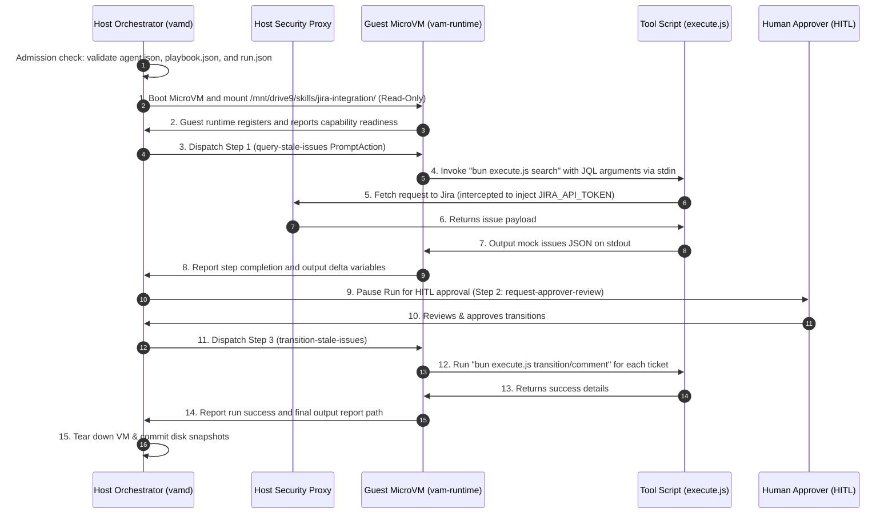

# Jira Assistant Example for VAM

This example directory demonstrates a complete autonomous agent setup for **VAM (Virtual Agentic Machine)** designed to act as an agile project management coordinator. It illustrates how the different protobuf definitions from the `proto/` directory are realized in practice as JSON declarations and executable guest scripts.

## Directory Structure

```text
examples/jira-assistant/
├── README.md               # This documentation guide
├── agent.json              # Desired state definition (AgentSpec)
├── playbook.json           # Dual-layer procedure (PlaybookSpec)
├── run.json                # Execution request and inputs (RunSpec)
└── skills/
    └── jira-integration/
        ├── SKILLS.md       # Skill manifest & system extensions (SkillManifest)
        ├── package.json    # Skill dependencies config
        └── execute.js      # In-VM unprivileged tool executor (LocalExecSpec)
```

---

## Component Reference

### 1. The Agent: [agent.json](file:///vam/examples/jira-assistant/agent.json)
Maps to **`vam.v1.AgentSpec`** (`proto/vam/v1/agentic_spec.proto`):
- Declares the professional baseline role and system instructions.
- Defines memory limits, reasoning budgets (ReAct loops capped to 20 iterations), and preferred LLMs (Gemini 2.5 Pro and Claude 3.5 Sonnet).
- Declares the required `jira-integration` skill by URN. The server resolves it at run time (the agent owner's draft, else the latest release) and freezes it to a version and digest at release.
- Restricts capability policies, hitl policies, and telemetry policies.

### 2. The Skill: [skills/jira-integration/SKILLS.md](file:///vam/examples/jira-assistant/skills/jira-integration/SKILLS.md)
Maps to **`vam.v1.SkillManifest`** (`proto/vam/v1/skills.proto`):
- Uses YAML frontmatter to declare four tools: `jira_search_issues`, `jira_create_issue`, `jira_transition_issue`, and `jira_add_comment`.
- Defines input JSON Schemas for each tool, which the LLM uses for function calling.
- Configures local execution (`LocalExecSpec`) instructing the unprivileged guest runtime to invoke the Bun script `execute.js` with action arguments.
- Identifies brokered secrets (`JIRA_API_TOKEN`, etc.) that are managed on the host and intercepted by the `vam-security` proxy.
- Appends secondary system prompt guidelines (Layer 2) in the Markdown body.

### 3. The Tool Executor: [skills/jira-integration/execute.js](file:///vam/examples/jira-assistant/skills/jira-integration/execute.js)
Maps to **`vam.v1.LocalExecSpec`** (`proto/vam/v1/skills.proto`):
- Executes inside the isolated Firecracker MicroVM with dropped privileges (`uid=1000`, `gid=100`).
- Standardizes parameter input using JSON from `stdin` and writes response payload to `stdout`.
- Calls Jira only through the in-guest egress proxy using scheme-less placeholders (`vamsec_jira_base_url/...`, `Authorization: vamsec_jira_auth_token`). The host vault supplies `jira/base-url` and `jira/auth-header`; the guest never receives the real tenant URL or credential.

### 4. The Playbook: [playbook.json](file:///vam/examples/jira-assistant/playbook.json)
Maps to **`vam.v1.PlaybookSpec`** (`proto/vam/v1/workflow.proto`):
- Ordered steps for sprint backlog maintenance. Each step carries an `instruction`. These examples are `agentic`: the model chooses the tool.
- Step 1 (`query-stale-issues`): find inactive tickets with `jira_search_issues`.
- Step 2 (`request-approver-review`): ask a scrum-master or project-manager to approve the move. Tool approval itself stays on the HITL overlay, not on the step.
- Step 3 (`transition-stale-issues`): move the approved issues to backlog and comment on each.
- Step 4 (`generate-report`): write the summary markdown file.

### 5. The Run: [run.json](file:///vam/examples/jira-assistant/run.json)
Maps to **`vam.v1.RunSpec`** (`proto/vam/v1/workflow.proto`):
- Binds the `jira-assistant` agent for a single prompt task (no playbook DAG required).
- Default prompt: search issue **CGA-1298**, then call `jira_transition_issue` to move it to **In Progress**.
- Cedar policy requires `hitl_approved` for `jira_transition_issue`; the host **Suspends** the run until a human approves.
- Establishes timeout budgets (30 minutes) and financial cost caps ($1.00).

#### HITL end-to-end test (vam-cli)

Prerequisites: `vamd` running, Jira secrets configured (`vam secrets set jira/base-url ...`, `vam secrets set jira/auth-header ...`).

```bash
# Start the run and follow events (run pauses when transition is attempted)
vam run --file examples/jira-assistant/run.json --follow

# In another terminal: list pending approvals
vam approve ls

# Inspect the transition request (issue key, args digest)
vam approve get <approval-id>

# Approve — run resumes and executes the transition
vam approve decide <approval-id> --decision approved
```

Cedar rules live in [policy.cedar](policy.cedar): `jira_search_issues` and `jira_add_comment` are allowed without approval; `jira_transition_issue` and `jira_create_issue` require `context.hitl_approved == true`.

---

## Execution Lifecycle Flow

The diagram below maps how the VAM system processes these files:


